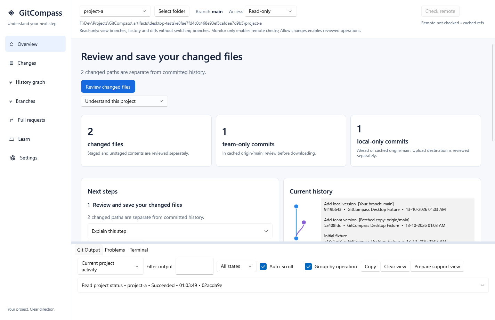
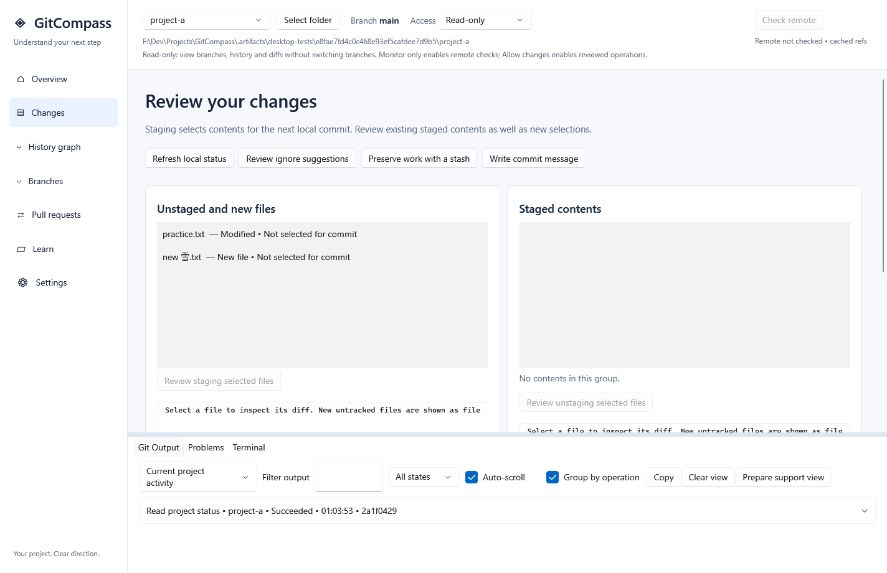
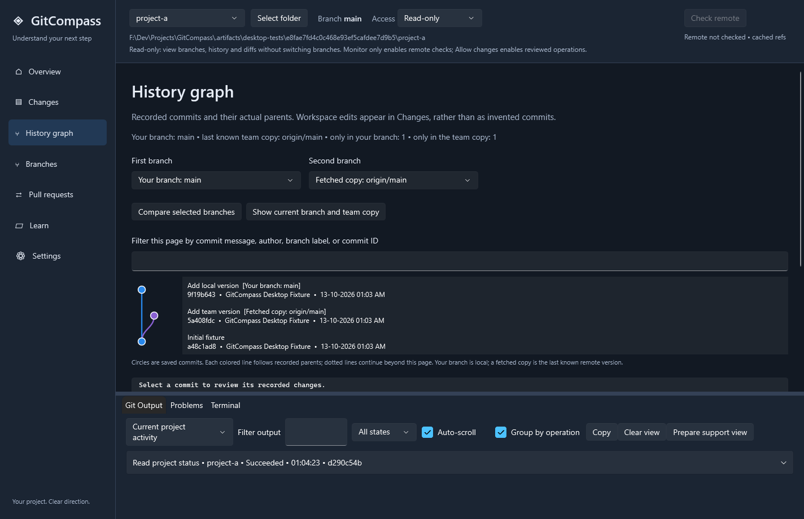

# GitCompass

**GitCompass is a Windows app that helps you learn Git by showing what changed in your project, where your work is saved, and what to do next.**

---

## Download

Get the latest version from the **[Releases page](https://github.com/abhranilp1998/GitCompass/releases)**.

> **Latest release: 0.3.0.** On the [Releases page](https://github.com/abhranilp1998/GitCompass/releases/latest):
>
> - **Recommended: `GitCompass-Setup-0.3.0.exe`.** Double-click it and follow Next, Next, Finish. No administrator rights needed. It adds GitCompass to your Start menu and can be removed from Windows Settings > Apps.
> - **Portable option: `GitCompass-0.3.0-win-x64.zip`.** Unzip the whole ZIP anywhere and run `GitCompass.exe`. Nothing is installed.
> To build from source instead, see [docs/DEVELOPING.md](docs/DEVELOPING.md).
>
> The current build is an early test version. It is not digitally signed yet, so Windows may show a blue "Windows protected your PC" box the first time you open it. Choose **More info**, then **Run anyway**.

## Quick start (4 steps)

0. **Install Git for Windows first.** It's free and takes about 2 minutes: [download Git](https://git-scm.com/download/win), run it and keep clicking Next. (If you forget, GitCompass shows you this step.)
1. **Download and install.** Run `GitCompass-Setup-0.3.0.exe` and open GitCompass from the Start menu. (Using the ZIP instead? Unzip the **whole** file, then open `GitCompass.exe` from inside that folder.)
2. **Answer one question.** The first time you open GitCompass, a welcome screen asks how much you know: *I'm brand new* (full walkthrough with practice missions), *I know a little* (just the key steps) or *I know Git* (a quick quiz, then skip ahead). Changed your mind? Use **Replay walkthrough** or **Show welcome screen again** in Settings or Learn, or press F1.
3. **Try the Learn page.** It explains the basics in plain language.
4. **Open a project.** Choose a folder. GitCompass opens it in **Read-only** mode first, so nothing in your files changes until you choose to allow it. When you're ready to save, choose **Allow changes** in the **Project access** box at the top. In the guided practice project, just press **Let GitCompass make changes here**.

Want to practise first? Use a practice project (source builds can create one with `scripts/create-practice.ps1`). It is a small throwaway folder with one saved version, one changed file and one new file, and it isn't connected to anything online.

## What you need

- Windows 11 (64-bit). Other Windows versions have not been tested yet.
- [Git for Windows](https://git-scm.com/downloads/win). GitCompass tells you if it can't find it.
- [Microsoft WebView2 Runtime](https://developer.microsoft.com/en-us/microsoft-edge/webview2/), only for the built-in terminal. Most Windows 11 PCs already have it.
- You do **not** need to install .NET, Visual Studio or a GitHub account.

## What it does

- **Shows what changed:** see which files you edited since your last saved version.
- **Helps you save versions:** pick the changes you want, then save them on your computer.
- **Shows your history** as a simple picture of saved versions and lines of work (branches).

- **Suggests the next step**, and shows you what an action will do before it happens.
- **Keeps you safe:** projects start in Read-only, and you decide when to allow changes.
- **Has a built-in Learn guide** that works offline.
- **Works with GitHub (optional):** upload your saved work and see review requests (pull requests). Some GitHub features need extra setup for now.
- **Looks good:** light, dark or system theme, and it fits small windows.

## Words you'll see

GitCompass uses everyday words first and puts the Git word in brackets, like **Save a version (commit)**, so you learn the real words as you go. Hover over a Git word in the app to see what it means.

<!-- glossary:start (generated from src/GitCompass.Domain/GitGlossary.cs; a test keeps it in sync) -->
| Everyday words | Git word | What it means | Official docs |
|---|---|---|---|
| Save a version | commit | A saved version of your project, stored on this computer. | [git-scm.com](https://git-scm.com/docs/git-commit) |
| Choose files to save | stage | Picking which changed files go into your next saved version. | [git-scm.com](https://git-scm.com/docs/git-add) |
| Line of work | branch | A separate line of work, so you can try ideas without changing the main one. | [git-scm.com](https://git-scm.com/docs/git-branch) |
| Combine work | merge | Joining the saved work from one line of work into another. | [git-scm.com](https://git-scm.com/docs/git-merge) |
| Upload | push | Sending your saved versions to the online copy. | [git-scm.com](https://git-scm.com/docs/git-push) |
| Get updates | pull | Getting new saved versions from the online copy and adding them to your work. | [git-scm.com](https://git-scm.com/docs/git-pull) |
| Check for updates | fetch | Checking the online copy for new saved versions, without changing your files. | [git-scm.com](https://git-scm.com/docs/git-fetch) |
| Online copy | remote | The online copy of your project, for example on GitHub. It is often named origin. | [git-scm.com](https://git-scm.com/book/en/v2/Git-Basics-Working-with-Remotes) |
| Download a copy | clone | Downloading a full copy of a project, with all its history, into a new folder. | [git-scm.com](https://git-scm.com/docs/git-clone) |
| Set work aside | stash | Putting unfinished edits aside for a while so you can come back to them. | [git-scm.com](https://git-scm.com/docs/git-stash) |
| What changed | diff | What changed between two versions: lines taken out and lines added. | [git-scm.com](https://git-scm.com/docs/git-diff) |
| Clashing changes | conflict | Two changes touched the same lines, so Git needs you to pick what to keep. | [git-scm.com](https://git-scm.com/book/en/v2/Git-Branching-Basic-Branching-and-Merging) |
| Project with history | repository | A project folder where Git keeps every saved version. Often called a repo. | [git-scm.com](https://git-scm.com/book/en/v2/Git-Basics-Getting-a-Git-Repository) |
| Review request | pull request | Asking your team to look at your uploaded work and add it to theirs. Not the same as pull. | [docs.github.com](https://docs.github.com/en/pull-requests/collaborating-with-pull-requests/proposing-changes-to-your-work-with-pull-requests/about-pull-requests) |
| Your own copy | fork | Your own online copy of someone else's project, so you can suggest changes without changing theirs. | [docs.github.com](https://docs.github.com/en/pull-requests/collaborating-with-pull-requests/working-with-forks/about-forks) |
| You are here | HEAD | Where you are right now: usually the newest saved version on your current line of work. | [git-scm.com](https://git-scm.com/book/en/v2/Git-Internals-Git-References) |
<!-- glossary:end -->

## FAQ

**Do I need a GitHub account?**
No. Git works on your computer by itself. GitHub is only needed if you want to share your work online.

**What's the difference between Git and GitHub?**
Git keeps the history of your project on your computer. GitHub is a website where you can upload that history to share it or back it up.

**Can GitCompass break my project?**
New projects open in Read-only, so GitCompass only looks. When you allow changes, it shows what will happen before it does anything.

**Does it stop other apps from changing my files?**
No. Its safety settings only apply inside GitCompass.

**Windows says the app is unrecognized. Is that normal?**
Yes, for now. This early version isn't digitally signed yet. Choose **More info**, then **Run anyway**.

**Where can I read more?**
See the [user guide](docs/user-guide.md), or the [full manual](docs/functional-documentation.md) for every screen in detail.

## For developers

Building from source, tests and project structure are covered in **[docs/DEVELOPING.md](docs/DEVELOPING.md)**.

## License

GitCompass is free and open source under the [MIT License](LICENSE). Bundled third-party parts are listed in [THIRD_PARTY_NOTICES.md](THIRD_PARTY_NOTICES.md).
