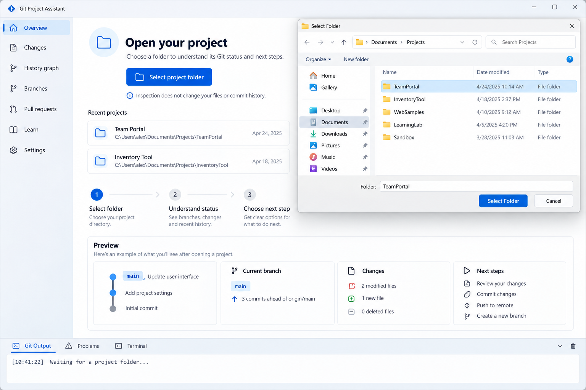
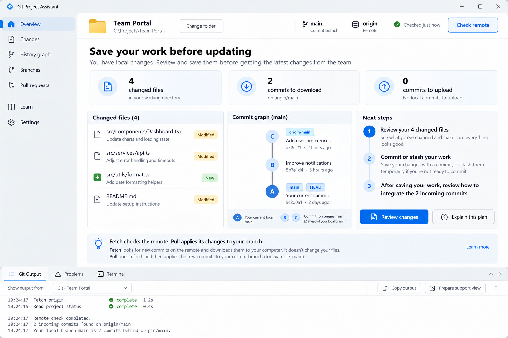
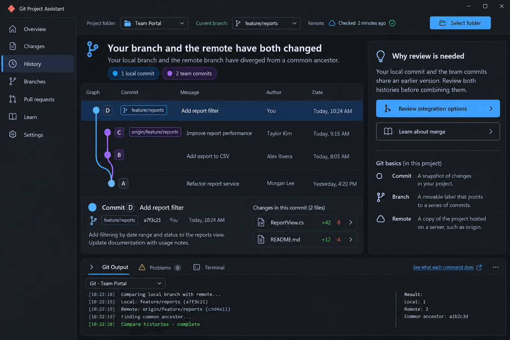
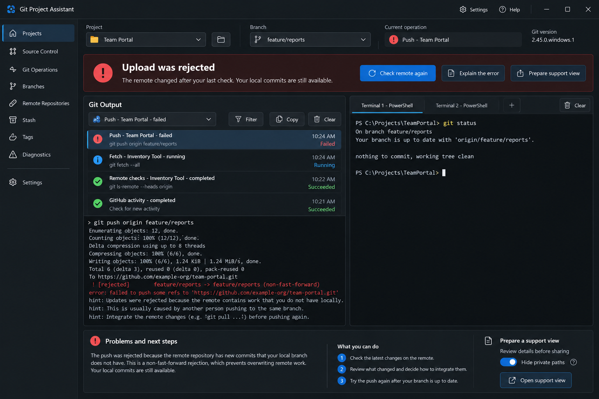

# Git Project Assistant Build Specification

Functional specification technical specification and standard operating procedures

Version 1.0 | 12 October 2026 | Planning baseline

## Contents

- [1 Purpose and recommended direction](#1-purpose-and-recommended-direction)
- [2 Research findings and feasibility](#2-research-findings-and-feasibility)
- [3 Users and operating model](#3-users-and-operating-model)
- [4 Functional requirements](#4-functional-requirements)
- [5 Main interface and action explanations](#5-main-interface-and-action-explanations)
- [6 Repository state and recommendation rules](#6-repository-state-and-recommendation-rules)
- [7 Fetch update and push behavior](#7-fetch-update-and-push-behavior)
- [8 Output terminal and support requirements](#8-output-terminal-and-support-requirements)
- [9 History ignore rules learning and collaboration](#9-history-ignore-rules-learning-and-collaboration)
- [10 Technical specification](#10-technical-specification)
- [11 Colleague SOP for first publishing and migration](#11-colleague-sop-for-first-publishing-and-migration)
- [12 Colleague SOP for daily synchronization](#12-colleague-sop-for-daily-synchronization)
- [13 Colleague SOP for branches PRs and errors](#13-colleague-sop-for-branches-prs-and-errors)
- [14 Development SOP from an empty repository](#14-development-sop-from-an-empty-repository)
- [15 Implementation milestones and release gates](#15-implementation-milestones-and-release-gates)
- [16 Acceptance and verification plan](#16-acceptance-and-verification-plan)
- [17 Decisions assumptions and unresolved inputs](#17-decisions-assumptions-and-unresolved-inputs)
- [18 Research sources and maintenance](#18-research-sources-and-maintenance)
- [19 Approved visual direction](#19-approved-visual-direction)

## 1 Purpose and recommended direction

Build a modern Windows application that helps colleagues move from project ZIP copies and Google Drive backups to an understandable Git workflow. After the user selects a project folder, the app should explain its current state, recommend the next steps, show the history, and provide the controls and evidence needed to complete the work.

The primary workflows are **fetch, pull or update, commit, and push**. Branches, merges, pull requests, ignore rules, and other Git commands must also be explained. Learning should happen within the app at the point where the user needs it. A colleague should be able to answer: What changed? Where is my work saved? What needs downloading or uploading? What will this action do? If it fails, how can I show the problem to the team developer?

**Selected stack:** C# with .NET 10 LTS and WPF using Fluent styling; the installed Git command-line executable for repository operations; a separate GitHub API adapter for hosted features; and a real terminal hosted with ConPTY and a locally packaged xterm.js renderer in WebView2. Use a deterministic decision engine for advice. An AI service is not required for the core product. WPF is selected for the Windows desktop workspace, resizable panels, graphics and .NET integration. This is an architectural recommendation, not a performance benchmark. Microsoft's WPF Fluent support is continuing to improve, so prototype the actual controls and terminal early. Validate the exact OS and deployment matrix in that prototype. [S3](https://dotnet.microsoft.com/en-us/platform/support/policy/dotnet-core) [S15](https://learn.microsoft.com/en-us/windows/console/creating-a-pseudoconsole-session) [S17](https://learn.microsoft.com/en-us/microsoft-edge/webview2/get-started/wpf) [S26](https://learn.microsoft.com/en-us/dotnet/desktop/wpf/overview/) [S27](https://learn.microsoft.com/en-us/dotnet/desktop/wpf/whats-new/net100)

The user has approved the four visual concepts as views of **one integrated application**. Folder selection, status and next steps, history and learning, output channels, errors and terminal sessions share one project context and one consistent shell. Light and dark images represent themes of the same application. Use the concept images as visual direction, while this specification defines actual behavior.

This document is a self-contained implementation brief for Codex or a developer starting from an empty repository. It includes product requirements, technical contracts, colleague SOPs, build milestones, acceptance scenarios and source references. Numerical defaults are initial proposals to validate during the pilot. The documents specify a product to build; they do not claim that the application already exists.

The application is feasible. Its main engineering challenge is making advice correct, understandable, and recoverable when the repository, network, or another tool changes state. An integrated terminal adds a substantial integration task and must be prototyped early.

### Mandatory first release capabilities

- Select a project folder and detect whether it is an existing Git repository.
- Show current status and an ordered action plan with reasons and prerequisites.
- Explain and perform the main daily Git operations through deliberate user actions.
- Automatically fetch for enabled repositories and notify users about meaningful changes.
- Provide a Git history graph inside the app and built-in learning material.
- Provide live output channels separated by project, process and operation, showing progress, results and errors.
- Provide a real integrated terminal with multiple named sessions within the application.
- Present failures in a form suitable for a screenshot or a reviewed support export.
- Suggest and explain project-specific ignore rules.
- Open new projects in strict Read-only mode; require explicit access changes before fetch or repository writes; enforce the selected mode in the operation engine.

These are release requirements, not optional polish. More advanced execution controls can follow the initial release, while their explanations remain available in the learning library.

### How to read this plan

Sections 2 to 5 explain feasibility, scope, and the interface. Sections 6 to 10 specify behavior and technical boundaries. Sections 11 to 14 provide colleague and development SOPs. Sections 15 to 18 define sequencing, acceptance, decisions, and research sources. Defaults and targets in this plan are proposals for implementation, not measured results or approved company policy.

Section 19 carries the approved visual concepts into the same application. The companion Codex starter file provides a short execution brief; this main specification remains self-contained.

<!-- pagebreak -->

## 2 Research findings and feasibility

### What the underlying systems provide

Git can report the current branch, upstream, staged and unstaged changes, untracked files, and commits ahead of or behind the configured upstream. Its machine-readable status format is appropriate for an application. A fetch refreshes local knowledge of remote history. A pull includes a fetch and an integration step that can change the current branch and files. These operations need distinct labels and explanations. [S4](https://git-scm.com/docs/git-status) [S5](https://git-scm.com/docs/git-fetch) [S6](https://git-scm.com/docs/git-pull)

GitHub provides pull requests and review metadata through its APIs. A pull request proposes merging changes into a target branch; it is a hosted collaboration feature, separate from the Git pull command. Git authentication and GitHub API authentication must be handled as separate capabilities. [S10](https://docs.github.com/en/pull-requests/reference/pull-requests) [S11](https://docs.github.com/en/apps/creating-github-apps/authenticating-with-a-github-app/generating-a-user-access-token-for-a-github-app) [S12](https://github.com/git-ecosystem/git-credential-manager) [S13](https://docs.github.com/en/rest/pulls/pulls)

| Capability | Feasibility | Qualification that the app must explain |
| --- | --- | --- |
| Folder detection and local status | High | Nested repositories, worktrees, empty repositories, and invalid metadata need distinct handling. |
| Fetch and synchronization notifications | High | Requires access to the chosen remote. Advice reflects the last successful check, not an instantaneous view of the server. |
| Recommendations for pull and push | High | Requires a known upstream, fresh enough remote data, a valid branch, and the relevant team policy. |
| Embedded commit graph | High | Parent relationships are available; lane layout, pagination, and accessible navigation require UI engineering. |
| Ignore suggestions | High | Stack-based recommendations need a preview. Existing tracked files and secrets require separate handling. |
| Wrong branch warning | Conditional | The user, task, or team settings must identify the intended branch. The app cannot infer intent reliably from a branch name alone. |
| Conflict preview | Conditional | A preview can evaluate a specified merge of committed snapshots. It cannot guarantee conflict-free future operations. |
| Integrated terminal | High with an early prototype | Requires a terminal renderer, a Windows pseudoconsole, lifecycle management, and reliable input and resize handling. |
| In-app PR guidance and creation | High | Requires GitHub permissions, published source commits, and correct source and target selection. |
| Import from ZIP copies | High for the current snapshot | ZIP files do not establish genuine commit authorship or historical branch relationships. Historical conversion is a separate project. |

### Existing tools and the product hypothesis

GitHub Desktop already supports graphical synchronization, branch workflows, a beginner tutorial, and PR preparation. Its documentation explicitly separates checking for remote commits from pulling them. This establishes useful behavior to study; fetch and push buttons alone are not a differentiator. [S22](https://docs.github.com/en/desktop/working-with-your-remote-repository-on-github-or-github-enterprise/syncing-your-branch-in-github-desktop) [S23](https://docs.github.com/en/desktop/working-with-your-remote-repository-on-github-or-github-enterprise/creating-an-issue-or-pull-request-from-github-desktop) [S24](https://docs.github.com/en/desktop/overview/creating-your-first-repository-using-github-desktop)

Our proposed value is a single workspace that ties observed repository state to plain-language next steps, a visible graph, contextual command lessons, and support evidence. Validate that hypothesis with colleagues using real examples of their confusion. Measure whether they understand the operation and can complete it independently; do not assume that adding more descriptive text alone will solve the problem.

### Boundaries of the promise

The app can reduce avoidable conflicts through earlier checks, smaller changes, appropriate branch guidance, and explicit integration choices. It must still support actual conflict resolution. It must distinguish recorded commits from unsaved editor buffers, and an unpushed commit from a change that has not yet been committed. It must use labels such as unknown or not checked when the available evidence cannot support a conclusion.

<!-- pagebreak -->

## 3 Users and operating model

### Intended users

**Colleague learning Git:** wants to open a familiar project folder, save a meaningful version, upload it, receive others' changes, and understand errors without memorizing commands.

**Team developer or lead:** helps diagnose problems, sets repository conventions, reviews changes, and explains branches or PRs when the team adopts those workflows.

**Application maintainer:** maintains Git compatibility, operating-system support, help content, authentication, and release quality. One person may hold more than one role.

### Local work and connected work

| Available locally | Requires remote access for GitHub |
| --- | --- |
| Repository detection, status, changes, history, graph, and cached advice | Fresh remote fetch and accurate new remote-commit detection |
| Staging, committing, local branches, and supported local integration | Clone from GitHub, push, publish a branch, and remote verification |
| Built-in lessons, command reference, and practice repository | Live PRs, reviews, checks, permissions, and GitHub sign-in |
| Output history and an integrated terminal | Hosted repository creation or other GitHub API writes |

Local Git operations should remain usable without an internet connection. Cached remote and PR data must display their last successful check. A network failure must not overwrite previously known information with an apparently successful zero count. Actual network requirements depend on the remote transport; the initial company workflow assumes GitHub over the network.

Local availability does not override access permissions. Staging, committing, integration and the terminal still require Allow changes even while offline.

### Proposed working defaults

- GitHub is the first hosted integration. Generic Git remotes still support ordinary Git operations where their transport is configured.
- The team chooses a canonical repository and an authorized branch workflow. The app must support a simple current-branch workflow as well as feature branches and PRs.
- Show the current branch everywhere an operation could affect it. Explain protected-branch restrictions when they are known.
- Offer periodic fetch during onboarding. It runs only after the user selects Monitor only or Allow changes. Start with a configurable five-minute interval, plus a manual Check remote button.
- Keep background monitoring active while the app is running. Continued tray operation and start at sign-in are explicit settings. Closing the app fully stops monitoring.
- Require the user to initiate commits, pulls or other integrations, pushes, branch changes, and conflict edits.
- Make the standard update path fast-forward only when the current branch is only behind and the working tree satisfies the app's preflight rules. Divergence opens a separate guided choice. [S6](https://git-scm.com/docs/git-pull)
- Use concise explanations first, with expandable details and command examples. Avoid repeated notifications for unchanged state.

### Versioning and backup during adoption

Keep a dated ZIP snapshot during first-time migration until the initial remote upload and a clean verification clone have been checked. Git records selected files and committed history; ignored local configuration, external databases, and other assets still need the team's backup process. The app does not delete the company's existing archives or Drive backups.

<!-- pagebreak -->

## 4 Functional requirements

P0 means required for the first usable pilot. P1 means required for the fuller release after the pilot. P2 means later execution features; reference material can cover them earlier. The mandatory project picker, dashboard, output pane, terminal, and diagnostic support remain P0.

| ID | Priority | Required behavior |
| --- | --- | --- |
| FR01 | P0 | Select a folder; resolve its actual repository root; detect no repository, existing repository, worktree, nested repository, or invalid metadata. |
| FR02 | P0 | Guide first-time migration, initialize only on request, review files and ignore rules, connect to a chosen remote, and verify the initial upload. |
| FR03 | P0 | Show current branch, upstream, tracked and untracked changes, stage state, ahead and behind counts, last fetch, and active Git operations. |
| FR04 | P0 | Produce an ordered action plan from observed state and a user goal, with reasons, prerequisites, effects, and alternatives. |
| FR05 | P0 | Fetch enabled remotes on a configurable schedule, after connectivity returns, and on request; notify only about relevant state changes. |
| FR06 | P0 | Guide updating the current branch and stop the simple path for divergence, conflicts, unsafe local changes, or unknown tracking. |
| FR07 | P0 | Preview, stage and unstage selected contents; commit locally; show the destination and outgoing commits before a normal push. |
| FR08 | P0 | Suggest ignore rules from detected project types, preserve existing rules, and show which files will be affected. |
| FR09 | P0 | Show an embedded graph of commits, parents, current branch and fetched upstream, with selectable commit details. Expand comparisons and filters in P1. |
| FR10 | P0 | Stream separate Git, background-check and GitHub activity channels; group each process by operation; show progress, result and error meaning; retain recent operations; expose copy and filter controls. |
| FR11 | P0 | Provide real integrated terminal sessions rooted in the chosen project, with multiple named tabs, input, scrolling, resizing, interruption, and clean session shutdown. |
| FR12 | P0 | Provide a screenshot-friendly support view and a locally saved, reviewed diagnostic summary. |
| FR13 | P0 and P1 | Ship offline lessons for daily commands in P0 and a searchable reference for all core Git commands in the supported version in P1. |
| FR14 | P0 and P1 | Detect merge, rebase, or other interrupted operations in P0; guide selected merge resolution and abort in the pilot; expand the resolver in P1. |
| FR15 | P1 | Create and switch branches, set task branch intent, explain branch relationships, and warn against a configured branch mismatch. |
| FR16 | P1 | Explain PRs; preview source and target; create a draft or ready PR through a confirmed action; display hosted status. |
| FR17 | P0 | Support offline operation, accessible navigation, light and dark themes, and understandable empty, blocked, busy, and error states. |
| FR18 | P0 | Store settings and logs locally, protect credentials, recheck state before writes, and handle external Git activity without stale actions. |
| FR19 | P0 | Provide Read-only, Monitor only and Allow changes access levels; default new projects to Read-only; block disallowed operations centrally, including terminal creation/input, queued work and background fetch. |
| FR20 | P0 | Support a recent-project list and switching between registered projects; preserve operation and terminal ownership and isolate each project's state and output. |

### Access mode requirements

Use one visible Access mode control beside the project and branch. A dropdown or compact selector shows Read-only, Monitor only and Allow changes. Read-only is the initial state of each newly registered project. Display the mode in diagnostics and on every operation preview.

| Access level | Repository effects allowed | Network behavior | Terminal |
| --- | --- | --- | --- |
| Read-only | Local inspection only; no worktree, index, refs, object database or Git configuration writes initiated by the app. | Use cached information; scheduled and manual fetch are blocked. | Do not start a shell or accept input; existing saved output can be viewed. |
| Monitor only | Local inspection plus the narrowly permitted fetch updates to Git metadata. | Fetch and read-only GitHub API checks are allowed after setup. | No interactive shell or input. |
| Allow changes | Reviewed guided operations, permitted previews and manual shell commands. | Fetch, deliberate push, and enabled GitHub writes. | Real interactive sessions allowed. |

Read-only concerns the selected repository and remote, not the application's own preferences, caches or redacted logs stored elsewhere. Other editors and Git clients retain their own permissions. Do not describe the app's mode as an operating-system sandbox for arbitrary programs.

Allow changes requires an explicit per-project unlock and lasts only for the current app session. It does not automatically commit, update or push. Remembering Monitor only is a separate opt-in setting for background checks; never persist unrestricted write permission across app restarts. Switching to a stricter level revokes queued permissions immediately. Do not show Read-only as active while an app-owned write or interactive terminal is still running: finish or cancel the owned operation, close the project's shell sessions with a clear choice, re-inspect, then report the mode transition complete.

Disabled controls remain understandable: explain which capability is needed and what enabling it permits. The rule engine can still describe a next step in Read-only, but cannot execute it. A context-menu action, shortcut, scheduler, retry or web message must pass the same engine-level permission check as a button.

### Scope of command execution

The guided controls initially implement the everyday operations in FR02, FR05, FR06, and FR07, plus the recovery steps needed for them. Reference coverage is broader than guided execution. The integrated terminal remains available for manual commands. Advanced guided rebase, cherry-pick, bisect, worktree management, submodule changes, history rewriting, and force-push controls are later features with explicit prerequisites.

<!-- pagebreak -->

## 5 Main interface and action explanations

### Workspace layout

**Top bar:** project selector and Select folder, actual repository location, current branch, Access mode, chosen remote, connectivity, last successful remote check, and Check remote. In Read-only, explain why the remote check is unavailable and label comparisons as cached.

**Navigation:** Overview, Changes, History graph, Branches, Pull requests, Learn, and Settings. Unsupported or unavailable features show an explanation instead of a misleading empty result.

**Overview:** a short status sentence, local changes, pending uploads and downloads, and an ordered plan. Examples include Review 3 changed files, Download 2 commits, and Upload 1 local commit. These counts describe different facts and must not be combined into a single pending-changes number.

**Changes:** unstaged and staged groups, diffs, ignore suggestions, a selected-files list, and commit entry. Existing staged files must be visible. A beginner must be able to see exactly which contents will enter the commit.

The initial commit action commits the whole reviewed index. Do not silently add or remove pre-existing staged work to create a subset commit. File-level stage and unstage are required; partial-hunk staging can follow later.

**History graph:** branch labels and commit relationships with a legend and keyboard-accessible details. Uncommitted changes appear as a separate workspace item rather than an invented commit.

**Bottom dock:** separate Git Output, Problems, and Terminal tabs. The dock is resizable, can be expanded, and stays associated with the selected project. Switching the project does not silently redirect an existing terminal session to a different folder.

**One application shell:** share navigation, project identity, theme, typography, keyboard shortcuts, status freshness, operation tracking and settings across all views. Use Overview as the default after selecting a folder. Its compact graph opens History graph; its changed-file count opens Changes; its recommended action opens the corresponding review. Keep the dock available on each page. Detailed learning and diagnostics open inside the same shell. A user can see status, a graph preview, next steps and output together without placing every advanced feature on the Overview page.

### Recommendation contract

Every recommendation must state the goal, observed evidence, proposed action, reason, prerequisites, expected changes, and how to recover if that particular operation fails. Show the exact underlying command in an expandable section, together with an original explanation and a link to the relevant built-in lesson.

Example: Your branch has 2 commits from the team that are not in your local history. Check their changes, then update this branch. Your files will change when the update runs. This recommendation is based on the remote check completed at the displayed time.

Offer user goals such as Upload my work, Get the latest changes, Understand this error, Start a task, and Prepare a pull request. Goal selection identifies intent; repository facts decide which steps are available. The app must not infer a desired branch or a merge policy from filenames or an ambiguous request.

### Educational content within the workflow

The first lesson explains the journey from a changed file to a staged change, a local commit, and an uploaded commit. Fetch, pull, and push are illustrated as different transitions. PRs have their own lesson showing a source branch, target branch, review, and merge. Examples use a disposable practice repository, not the colleague's production project.

Explanations should answer one decision at a time. The complete reference remains searchable, but the primary screen shows the information needed for the current task. Screenshots should retain project context, branch, last check, operation, and result without requiring the user to navigate multiple pages.

<!-- pagebreak -->

## 6 Repository state and recommendation rules

### Snapshot model

Capture the repository root and worktree, Git version and capabilities, current branch or detached state, HEAD commit, upstream and remote destination, staged and unstaged changes, untracked and conflicted paths, ongoing Git operation, remote-check result and time, intended branch if configured, and applicable workflow policy.

Represent branch tracking, working-tree changes, active operations, remote freshness, and user intent as separate dimensions. A branch can be only behind while also containing uncommitted edits. The resulting advice must account for both facts.

| Observed state | Primary advice | Execution condition |
| --- | --- | --- |
| No repository | Choose initialization or cloning | Explain the destination and do not initialize automatically. |
| No commits yet | Review ignore rules and make the first commit | No ahead or behind claim is available yet. |
| No upstream | Choose the intended tracking or publication target | Never assume that every branch tracks the default branch. |
| Ahead 0 and behind 0 | No known commit synchronization needed | Still show local edits and the age of the last check. |
| Ahead above 0 and behind 0 | Review outgoing commits and push | Check branch policy, actual push destination, and remote access. |
| Ahead 0 and behind above 0 | Review incoming commits and update | Simple path requires a suitable clean state and valid tracking. |
| Ahead and behind both above 0 | Histories have diverged; review integration choices | Use the configured merge or rebase policy; do not force push as a shortcut. |
| Uncommitted changes before integration | Preserve or complete the work first | Offer commit, an explained stash, or postponement; never silently discard it. |
| Conflicts or an interrupted operation | Resolve, continue, or abort the recorded operation | Suspend ordinary commit and sync flows until the operation is understood. |
| Detached HEAD | Explain and help attach work to a branch | Suppress ordinary branch publication assumptions. |
| Intended branch differs | Warn and show the intended branch | Only make this claim when intent is explicitly known. |
| Offline or failed fetch | Keep local work available and mark remote data stale | Do not claim the server is synchronized. |
| Remote rewritten or upstream missing | Show the changed relationship and request a reviewed decision | Do not classify this as a routine update. |

### Evidence and freshness

Ahead and behind counts compare commits reachable from the local branch and the fetched upstream, not merely commit-message strings. Machine-readable Git status and revision counts support this calculation. Patch-equivalent commits after a rebase can still have different identities; explain that if it affects advice. Shallow repositories may have incomplete history and need a limited-history indicator. [S4](https://git-scm.com/docs/git-status) [S25](https://git-scm.com/docs/git-rev-list)

The pull target and push target can differ in a fork or with custom Git configuration. Resolve and display both. Recompute the plan after each operation and before executing any queued write. If an external editor or terminal changes the relevant state, invalidate the old action preview and show a new one.

**Rule order:** active-operation recovery first, repository and tracking problems second, intent and policy conflicts third, preservation of local work fourth, then normal synchronization. The interface can display all relevant facts, while the primary action follows the highest-priority prerequisite.

Execution has an additional first gate: the current access level must permit the operation. Recommendations remain visible as plans even when access prevents execution.

<!-- pagebreak -->

## 7 Fetch update and push behavior

### Automatic remote checks

Monitor only registered repositories whose background checks are enabled. Fetch the configured relevant remote, not every discovered URL. Establish sign-in through a user-initiated action. Background checks should not repeatedly open login prompts. Authentication failures pause that repository's remote checks and produce one actionable message.

Use a scheduler with jitter, bounded concurrency across repositories, and serialization for shared Git metadata. Slow down after network or server failures. Resume after connectivity returns and respect rate limits for GitHub API requests. Fetch scheduling and API polling are different mechanisms. The local app can use efficient periodic API checks when it has no webhook receiver, with conditional requests where supported. [S14](https://docs.github.com/en/rest/using-the-rest-api/best-practices-for-using-the-rest-api)

After a successful fetch, refresh the snapshot and compare it with the previous meaningful state. Notify about new incoming commits, divergence, a disappeared tracking branch, or other actionable changes. Keep unpushed local commits visible without repeated reminders. Clicking a notification opens the affected repository and its plan; it does not run an integration.

### Update the current branch

The simple Update action means applying the configured upstream's reviewed history to the current branch. It does not mean downloading dependencies, updating application software, or automatically merging the team's default branch into every feature branch.

Preflight checks the branch, upstream, local changes, conflicts, active operations, and freshness. When the branch is only behind, fetch and review incoming changes, then fast-forward the branch. An implementation can fetch, record the upstream commit, revalidate the snapshot, and fast-forward to that reviewed commit. The command lesson can also explain `git pull --ff-only`; the engine should specify behavior explicitly rather than depend on version or configuration defaults. [S6](https://git-scm.com/docs/git-pull)

Also check untracked and ignored paths that incoming changes could overwrite. A clean tracked-file status is not sufficient to prove these local files are safe. The managed merge/update path uses no-overwrite-ignore behavior and stops on collisions rather than silently replacing private local files.

If histories diverge, explain both sides and offer the allowed integration method. Begin with guided merge support for shared-branch divergence. Rebase guidance must distinguish unpublished local work from shared history and follow team policy. Updating a feature branch from a PR's base is a separate operation with a separately selected target.

### Upload committed work

Commit creates a local recorded version. Push uploads committed history to the displayed destination. Unstaged changes, editor buffers, ignored files, and ordinary local stashes are not uploaded by a normal push. The UI must show outgoing commits and destination before proceeding. [S7](https://git-scm.com/docs/git-push) [S21](https://git-scm.com/docs/git-stash)

Refresh the relevant remote knowledge before the upload. If the server changes afterward, handle a rejected push by refreshing and rebuilding the plan. Never substitute a force push automatically. If network interruption leaves the result uncertain, verify the destination before labeling the upload failed or encouraging another action. Confirm successful publication from Git's result and subsequent remote verification.

### Operations with lasting effects

The app must distinguish automatic checking from deliberate changes. It must not silently pull, commit, push, rebase, delete branches, change tracking, edit ignore rules, or remove files. A universal Sync button must not hide these transitions. It can present a reviewed sequence, stopping at decisions and refreshing between steps.

<!-- pagebreak -->

## 8 Output terminal and support requirements

### Output channels

Provide a VS Code style bottom dock with Git Output, Problems and Terminal. Output is a record of app-managed processes; Terminal is an interactive shell. Neither can substitute for the other.

Channels have stable human-readable names, such as Git - Team Portal, Remote checks - Inventory Tool, and GitHub activity - Team Portal. Within a channel, each operation is a separate expandable group. Show queued, starting, running, awaiting input, succeeded, failed, canceled and outcome unknown states; starting a process is not success. A combined activity view can show concurrent operations, but each line retains its project, channel and operation identity.

Each group shows purpose, project, branch, access level, sanitized command or API action, start time, progress, duration, exit code when applicable, result and a plain-language interpretation. Display stdout and stderr as distinct streams if useful. Git progress commonly uses stderr; do not classify all stderr as failure. Exit-code meaning is operation-specific: for example, a diff can intentionally report that differences exist. [S42](https://git-scm.com/docs/git-diff)

Provide channel selection, search, severity filters, pause auto-scroll, copy selected output, copy an operation, and clear the visible pane. Clearing the pane must not cancel work. Support carriage-return progress updates, long-running output and bounded scrollback without freezing the UI. Keep machine-oriented NUL records out of the human output view; show a readable summary while retaining parser diagnostics.

Persist redacted structured events locally. Initial limits: seven days or 50 MB in total, whichever is reached first; 10,000 visible events per channel, backed by virtualization. These are tuning defaults, not measured requirements. Signal truncation and provide a reviewed export when retained detail exists. Never silently report complete logs after truncation.

### Problems and recovery

Problems summarizes actionable failures and interrupted operations, with a link to the relevant output group. Each entry answers what failed, what remains intact, what is uncertain, and the next useful step. Distinguish authentication failure, lost connectivity, rejected push, protected branch, conflict, locked metadata, missing Git, missing upstream, invalid folder and unsupported capability.

Examples:

- Upload rejected: keep local commits visible; check the remote again; review incoming history before another normal push.
- Sign-in needed: explain whether Git transport or GitHub API access failed; offer the appropriate user-initiated sign-in.
- Integration conflict: list affected paths and show the recorded merge or rebase operation.
- Result unknown after interruption: re-inspect or verify the remote before presenting another write action.

Do not offer a reset, force push, deletion or arbitrary lock-file removal as generic error recovery.

### Real integrated terminal

Use Windows ConPTY to host a real shell, with a locally packaged xterm.js renderer in WebView2. Create the pseudoconsole, pipes and child process; service input and output independently; support resize and dispose owned handles correctly. Microsoft documents this lifecycle and its deadlock considerations. [S15](https://learn.microsoft.com/en-us/windows/console/creating-a-pseudoconsole-session) [S16](https://learn.microsoft.com/en-us/windows/console/createpseudoconsole)

Initial shell: Windows PowerShell already present on supported Windows machines. Detect PowerShell 7 as an optional preference. Users do not need Node.js to run the shipped application. Include terminal JavaScript, CSS and fonts with the app; never load them from a CDN.

Required terminal behavior:

- Multiple named sessions, each visibly associated with its originating project and shell.
- Keyboard input, output, scrollback, selection, copy, paste, resize and interrupt.
- Clear explanation before pasting multiline commands; pasting is a user action.
- Closing a session handles its owned child processes and reports unfinished work.
- Changing the selected project does not change an existing session's working directory.
- Terminal commands may change directory independently; label the starting project and show actual directory only when trustworthy shell integration supplies it.
- Re-inspect after relevant file changes and terminal activity, on focus return, and before every managed write. If command completion is not observable, use bounded polling while the terminal is visible and show analysis in progress.
- Read-only and Monitor only cannot create a shell, send terminal input or paste commands. Do not pretend command-name filtering makes a general-purpose shell read-only.

Terminal output is untrusted data. Restrict WebView2 navigation to the local terminal origin, validate message origins and schemas, and expose only session input, resize and close capabilities. Do not expose a generic filesystem or command-execution proxy. Render terminal data through xterm.js, not HTML injection. Disable automatic clipboard changes and automatic link execution; open reviewed links in the system browser. Keep API tokens out of the terminal environment. [S18](https://xtermjs.org/docs/guides/security/) [S46](https://learn.microsoft.com/en-us/microsoft-edge/webview2/concepts/security)

The app coordinates its own managed operations. A manual shell and other tools can still modify Git state; filesystem watchers and preflight checks cannot create an absolute transaction boundary around external programs. Detect known activity, pause conflicting managed writes when observable, respect Git's locks, and invalidate stale plans. Explain busy or uncertain state instead of presenting a false guarantee.

### Support view and diagnostic export

Prepare support view opens an in-app summary suitable for a screenshot. Include app version, Git version, OS build, project alias, branch, upstream and push destination aliases, access level, last successful remote check, operation, result, recovery advice and relevant redacted output.

Hide user names, absolute private paths, credential-bearing URLs and tokens by default. Offer reviewed fields to include; show exactly what will be exported. File diffs, source files, environment dumps, full repository contents and terminal scrollback are excluded unless the user deliberately selects relevant content. Never automatically send a report.

Save a small support bundle containing a readable Markdown summary and bounded redacted JSON events. A screenshot is useful for triage but is not guaranteed to diagnose every error. Redaction is best-effort and must be followed by a visible review.

<!-- pagebreak -->

## 9 History ignore rules learning and collaboration

### Embedded graph

Use real commit IDs and parent edges. Label HEAD, local branches and fetched remote branches distinctly. A simple behind-only history is a single chain; divergence has two paths from a common ancestor. Render merges with their actual multiple parents. Do not turn uncommitted edits into a synthetic historical commit.

Load an initial 200 rows, then page further history. Virtualize rows and retain a stable anchored view while background fetch changes refs. Parents outside the loaded range get continuation indicators, not invented nodes. Treat object IDs as opaque values rather than assuming a fixed 40-character length. Respect shallow history and missing objects with explicit indicators. Selecting a commit shows its message, author, date, changed paths and a bounded diff; binary files show metadata.

Provide current branch versus upstream comparison in P0 and selected branch comparisons and filters in P1. Provide a list representation and textual relationship summary for screen readers. Colors are supplementary; labels and line relationships carry meaning. Graph layout is app functionality, not a replacement for correct Git ancestry calculations. [S25](https://git-scm.com/docs/git-rev-list) [S44](https://git-scm.com/docs/git-log) [S48](https://git-scm.com/docs/git-merge-base)

### Ignore recommendations

Detect project types from files such as solution/project files, package manifests and build metadata. Propose relevant patterns and explain them. Start from reviewed templates, including GitHub's Visual Studio examples, but preserve existing rules and comments. Do not replace an entire ignore file blindly. [S8](https://git-scm.com/docs/gitignore) [S34](https://github.com/github/gitignore/blob/main/VisualStudio.gitignore)

Preview currently untracked files affected by the proposed rules. Apply only after the user allows changes and selects Apply. Record the existing ignore file for recovery and write changes atomically where possible. Root and nested ignore files, negation patterns, global excludes and repository-local excludes need distinct explanations.

Explain that an ignore rule does not stop tracking a file already committed. Removing a file from the index is a separate deliberate action that must preserve the working copy and show the exact paths. It does not remove past copies from history. Detection of a possible secret requires a separate response, not an ignore-only fix.

Flag likely credentials, environment files, private keys, very large files and generated build output during first publishing. This is a review aid, not a guarantee of secret detection. Do not ignore all configuration files, dependency lockfiles or assets indiscriminately. Large binary assets may need Git LFS, which introduces additional setup and remote support requirements. Detect and explain LFS repositories; do not silently migrate history. [S35](https://docs.github.com/en/repositories/working-with-files/managing-large-files/about-git-large-file-storage)

### Offline learning and command reference

Ship original plain-language lessons as local content with a versioned manifest. The daily workflow material is P0; searchable reference coverage for the supported core Git command inventory is P1. Include purpose, prerequisites, local and remote effects, when to use it, when to pause, a sample outcome and a disposable practice example.

Core lessons: status, diff, stage and unstage, commit, fetch, update/pull, push, clone/init, remote and upstream, ignore rules, stash, branches, merge, conflict recovery, PRs, and the difference between local work and uploaded work. Explain that PR is a GitHub collaboration request and is distinct from Git pull.

Use the installed Git help inventory to reconcile available commands with the bundled reference. Mark unsupported commands or options. Separate daily tasks, advanced user commands and plumbing. A basic entry must exist for every command in the declared supported core inventory by the full-release gate; third-party aliases and arbitrary external Git extensions are outside that promise. Deep examples can be expanded over time. [S19](https://git-scm.com/docs/git) [S43](https://git-scm.com/docs/git-help)

Do not embed an online chat dependency into core advice. Optional AI explanations, if added later, cannot execute commands, override mode permissions or replace deterministic facts. Existing help must work without the network. Review licenses before redistributing Git manuals or third-party material; links and original teaching content are the baseline.

### Branches and pull requests

The simple current-branch workflow remains usable for the team's initial habits. Do not force every daily action through a new branch or PR unless team policy requires it. Provide branch creation and switching in P1 with a visible base, intended task and preservation of local changes. A branch mismatch warning requires an explicitly configured intended branch.

The PR page explains source, target, draft, review, checks and merge. Show outgoing unpublished commits and require publication before creating the PR. Preview title, description, source repository/branch and target repository/branch. Handle fork relationships explicitly. Creating a PR requires Allow changes and a deliberate submission; an existing PR should be surfaced rather than duplicated after an uncertain response. [S10](https://docs.github.com/en/pull-requests/reference/pull-requests) [S13](https://docs.github.com/en/rest/pulls/pulls)

Treat mergeability as pending when the API has not calculated it; an unknown result is not a definitive conflict. Read permissions, reviews and checks where available. A missing or inaccessible private repository is not conclusively absent. First full release includes PR creation and status; automatic merging, review submission and merge-queue orchestration are later scope.

### Conflicts

The pilot must detect conflicted paths and an interrupted merge, explain local versus incoming versions, allow opening files, show diffs, stage the user's completed resolution, continue the supported merge or abort it. Label binary, rename/delete and complex conflicts that require an external editor or developer review. No automatic choice of ours or theirs.

A later committed-history preview can use merge-tree with an explicit target. Its modern mode does not modify the worktree or index, but can write objects to the object database; therefore it is not permitted in strict Read-only or Monitor only. It also cannot guarantee the result of a future merge after either side changes. [S9](https://git-scm.com/docs/git-merge-tree)

Require a suitable clean state before app-managed integration. Git warns that abort may fail to reconstruct pre-existing uncommitted work in some cases; an abort button is not a universal backup. Preserve work first, then use operation-specific recovery. [S40](https://git-scm.com/docs/git-merge)

<!-- pagebreak -->

## 10 Technical specification

### Stack decision and alternatives

| Component | Selection | Reason and validation |
| --- | --- | --- |
| Application language | C# | Broad .NET ecosystem and straightforward integration with WPF, async processes and Windows APIs. VB.NET is feasible but does not give a clear advantage for this product. |
| Runtime and desktop UI | .NET 10 LTS and WPF | Windows workspace, data binding, graphics and resizable panels; prototype the Fluent controls and OS matrix. |
| Presentation | MVVM with CommunityToolkit.Mvvm | Keep UI state and command enablement separate from repository behavior. |
| Git engine | Installed Git for Windows CLI | Preserve standard Git behavior, configuration and credential-helper integration; parse stable machine output. |
| Hosted integration | GitHub REST via typed HttpClient | Keep Git transport independent from API permissions and hosted metadata. |
| Terminal | ConPTY plus xterm.js in WebView2 | Real interactive shell with a terminal renderer; early lifecycle and accessibility spike. |
| Persistence | Versioned JSON settings and cache, redacted JSONL logs | Local, inspectable, no application server or database required initially. |
| Graph | Virtualized WPF rows and vector edges | Accessible commit list with bounded paging and explicit ancestry. |
| Tests | .NET unit tests plus real temporary Git fixtures | Verify state transitions and repository effects, not only mocked command strings. |
| Delivery | Self-contained Windows pilot package; signed deployment later | Validate prerequisites and installer behavior before selecting production distribution. |

WinUI 3 is Microsoft's recommended modern Windows framework and remains a reasonable alternative. WPF is chosen here as a practical desktop-workspace decision, with modern styling and terminal hosting to prove early. Electron offers a web UI with Node/native terminal tooling; Tauri introduces Rust plus web UI. They may fit a team with those skills or a cross-platform requirement, but neither is assumed faster or cheaper. The current product is Windows-only. [S1](https://learn.microsoft.com/en-us/windows/apps/winui/winui3/) [S26](https://learn.microsoft.com/en-us/dotnet/desktop/wpf/overview/) [S27](https://learn.microsoft.com/en-us/dotnet/desktop/wpf/whats-new/net100) [S28](https://learn.microsoft.com/en-us/dotnet/communitytoolkit/mvvm/) [S36](https://www.electronjs.org/docs/latest/tutorial/process-model) [S37](https://github.com/microsoft/node-pty) [S38](https://v2.tauri.app/start/prerequisites/)

### Platform and dependency contract

Target supported Windows 11 first. Validate the requested Windows 10 machines by edition, version and architecture. The current .NET 10 matrix lists specific Windows 10 Enterprise/IoT version entries, not blanket support for every Windows 10 installation. ConPTY requires Windows 10 version 1809 or later, so a runtime-supported older OS still may not meet the terminal baseline. Publish only the tested intersection of runtime, terminal, WebView2 and app support. [S16](https://learn.microsoft.com/en-us/windows/console/createpseudoconsole) [S20](https://github.com/dotnet/core/blob/main/release-notes/10.0/supported-os.md)

Provisional desktop target: net10.0-windows10.0.17763.0, with UseWPF enabled. The target-framework OS version expresses API availability; it is not a statement of vendor support for every machine with that build. Use net10.0 for platform-independent Domain code. Pin an SDK patch in global.json at implementation time and pin NuGet/npm versions and lockfiles.

Start with x64. Treat ARM64 as a separate build and test gate, not automatic compatibility. Detect Git and WebView2 at startup and show a setup page with official installation guidance if missing. Proposed Git minimum is 2.43, subject to capability tests and an explicitly documented tested matrix. Do not download or replace Git silently. Existing SSH and Git Credential Manager configurations should remain usable.

Development restoration may need internet access. After installation, local features, help, graph and terminal assets must operate offline. A WebView2 offline prerequisite package can be planned for managed deployment; do not assume a network bootstrap installer satisfies offline installation.

### Solution structure

Suggested starting structure:

~~~text
GitProjectAssistant.sln
global.json
Directory.Build.props
Directory.Packages.props
src/
  GitProjectAssistant.Desktop/          WPF shell and view models
  GitProjectAssistant.Domain/           immutable facts rules and policies
  GitProjectAssistant.Application/      use cases previews and orchestration
  GitProjectAssistant.Infrastructure.Git/
  GitProjectAssistant.Infrastructure.GitHub/
  GitProjectAssistant.Infrastructure.Local/
  GitProjectAssistant.Terminal.Windows/ ConPTY lifecycle and bridge
assets/
  terminal/                            packaged xterm assets
  learning/                            lessons reference and manifest
tests/
  GitProjectAssistant.Domain.Tests/
  GitProjectAssistant.Git.IntegrationTests/
  GitProjectAssistant.Desktop.Tests/
docs/
  specification.md
  decisions/
  verification.md
  user-guide.md
~~~

Dependency direction: Desktop and infrastructure implement application contracts; Application depends on Domain; Domain has no WPF, Git process, network or filesystem dependencies. The terminal bridge cannot bypass the application permission gate. Use dependency injection at the desktop composition root.

### Repository discovery and local inspection

Use the native WPF OpenFolderDialog with a single-folder choice; keep Select folder accessible throughout the app. Microsoft provides this dialog in modern WPF. Resolve a subfolder to its actual Git root and show both the selected location and repository root when they differ. [S41](https://learn.microsoft.com/en-us/dotnet/desktop/wpf/windows/how-to-open-common-system-dialog-box)

Detect bare repositories, linked worktrees, nested repositories, submodules, missing folders and invalid metadata. The initial editing UI supports ordinary working repositories and linked worktree inspection; bare repositories and advanced submodule/worktree operations show explained limitations rather than unsafe initialization. Do not decide that a folder is not a repository merely because it lacks a .git directory; .git may be a file.

Initial inspection must avoid repository mutations and configured executable helpers where possible: set GIT_OPTIONAL_LOCKS=0, disable configured filesystem-monitor execution for inspection, avoid external diff and text conversion drivers, and use typed known commands. Respect Git ownership protection. If Git refuses an unsafe directory, explain the ownership issue; never set a global safe.directory wildcard automatically. Repository trust must precede network transports and operations that can invoke configured helpers, filters or hooks. [S29](https://git-scm.com/docs/git-config)

### Domain data contracts

| Contract | Required fields or invariant |
| --- | --- |
| ProjectRegistration | ID, display name, selected folder, canonical root, common Git directory identity, transport setup, persisted monitoring permission, optional task branch intent, workflow policy. |
| RepositorySnapshot | Project ID, generation, observation time, HEAD ID, branch/detached/unborn state, upstream, actual push mapping, file states, operation state, ahead/behind or unknown, history limitations, freshness, capabilities and errors. |
| FileState | Exact path, original path for a rename, index status, worktree status, tracked/untracked/conflicted classification, binary/size metadata when inspected. |
| RemoteObservation | Remote and refs checked, result, successful observation time, relevant fetched IDs, current connectivity; failure does not erase the last successful observation. |
| RecommendationPlan | Snapshot generation, goal, ordered steps, reason codes, evidence, prerequisites, required capability, expected effects, alternatives and recovery. |
| OperationPreview | Project, operation kind, exact intended targets, reviewed commit IDs/file selection/index state, snapshot generation, capability and human explanation. |
| OperationRecord | Operation ID, channel, repository identity, access level, sanitized action, timestamps, state, result/exit interpretation, related structured events and verification outcome. |
| TerminalSession | Session ID, originating project/root, shell, process ownership, lifecycle, display name and bounded output; no secret token inheritance. |
| AccessGrant | Project ID, level, session identity, generation and revocation state; unrestricted access is not persisted. |

Represent unknown values explicitly; zero is a known number, not a placeholder for a failed check. Plans and previews are immutable, tied to a snapshot generation, and invalidated when their relevant evidence changes.

Before Git initialization or cloning, a registration can refer to a selected candidate folder rather than an existing Git root. Scope its access grant to that exact target and validate that discovery has not redirected the operation to a different parent or nested repository.

### Application interfaces

The implementation should expose equivalent contracts; names may change when recorded in the design decisions:

~~~text
IRepositoryInspector.ReadAsync(project, cancellation)
IRecommendationEngine.Build(snapshot, goal, policy)
IAccessPolicy.Authorize(project, operationKind, grant)
IOperationPlanner.PreviewAsync(request, snapshot, cancellation)
IOperationCoordinator.ExecuteAsync(preview, grant, cancellation)
IGitProcessRunner.RunAsync(executable, argumentList, cwd, environment, cancellation)
IRemoteCheckScheduler.Register(project, permittedSchedule)
IGitHubClient.ReadAsync / SubmitAsync(typed request, cancellation)
ITerminalHost.CreateAsync(project, shell, grant, cancellation)
IDiagnosticExporter.PrepareAsync(selectedOperations, redactionOptions)
~~~

The runner is internal to trusted infrastructure. Do not expose an unguarded Run arbitrary command action through a view model, shortcut or WebView message. All app-managed repository effects pass through the coordinator and capability policy.

### Command execution and parsing

Start Git by its validated absolute executable path using ProcessStartInfo.ArgumentList and UseShellExecute=false. Pass a specific working directory, disable paging for machine/app-managed output and control interactive prompting for background work. Never concatenate user paths, remote URLs, branch names or commit messages into a shell command. Use argument separators and literal pathspec handling where appropriate; validate refs with Git. Preserve filenames with spaces, Unicode and leading hyphens.

Drain stdout and stderr asynchronously and independently, with bounded buffering. Distinguish machine output from human output. Do not parse translated prose when a stable format exists. Initial command contract:

| Purpose | Command shape | Notes |
| --- | --- | --- |
| Locate repository | git rev-parse with show-toplevel and absolute Git/common-directory queries | Handle each supported flag/capability and bare/worktree cases. |
| Read status | git status --porcelain=v2 --branch -z --untracked-files=all | Parse branch headers, ordinary entries, renames, unmerged and untracked entries; do not split paths on spaces. Explicitly account for submodule/configuration reporting limits. |
| Compare histories | git rev-list --left-right --count HEAD...upstream | Left is local-only, right is upstream-only for this operand order; unavailable tracking means unknown. |
| Read graph | git log with topological order, parents and explicit field format | Page bounded results, validate records and preserve snapshot anchoring. |
| Read diffs | git diff with no-ext-diff, no-textconv and explicit cached/worktree target | Do not run repository-defined diff programs for inspection. |
| Explain ignores | git check-ignore with explicit machine/path handling | Tracked-file behavior requires separate index inspection. |
| Fetch | git fetch with no-tags, no-auto-maintenance, no-recurse-submodules and approved explicit mapping | Permit only in Monitor only or Allow changes; scope all effects to the selected repository. |
| Simple update | git merge --ff-only --no-overwrite-ignore with the reviewed upstream object ID | Revalidate first; preserve local work and stop on file collisions. |
| Stage | git add with exact reviewed literal paths | Handle deletions and existing staged contents; do not default to add everything. |
| Commit | git commit using reviewed index and message input/file | Use the user's identity; handle hooks and signing failures explicitly. |
| Push | git push with explicit reviewed remote and source/destination refspec | Normal push only; show actual configured push URLs. |

These are engine shapes, not instructions to run blindly on a user project. Status, ancestry, discovery, logs and diffs have official machine-oriented options; implement and test their parsers against the supported Git versions. [S4](https://git-scm.com/docs/git-status) [S25](https://git-scm.com/docs/git-rev-list) [S42](https://git-scm.com/docs/git-diff) [S44](https://git-scm.com/docs/git-log) [S45](https://git-scm.com/docs/git-rev-parse)

Upstream and push resolution must account for pushRemote, remote.pushDefault, push.default, branch tracking and push URLs. If a configuration produces multiple destinations or an ambiguous mapping that the engine cannot represent, block the guided push and ask for a specific target. Do not fall back to origin/main. The simple path deliberately supports one reviewed destination at a time.

Monitor-only fetch must use validated explicit destinations confined to the permitted remote-tracking namespace. Do not blindly inherit a custom fetch refspec that updates local branch refs or other unintended namespaces. Disable automatic tag following, tag pruning, automatic maintenance and recursive submodule fetch in this narrow path. Override inherited ref mappings with approved explicit mappings, using an empty refmap where supported, and scope pruning to the approved tracking refs. Object downloads, tracking-ref updates and FETCH_HEAD are the declared permitted effects; worktree, index, local branches, tags and Git configuration remain protected. Reject a configuration the planner cannot constrain. A failed fetch may have made partial metadata progress; record that uncertainty and do not present the comparison as a fresh complete server observation. [S5](https://git-scm.com/docs/git-fetch)

### Capability and operation coordinator

Maintain a capability registry rather than inferring permission from arbitrary command text. Inspection operations are allowed in all levels. Fetch and read-only hosted API operations require Monitor only or Allow changes. Worktree/index/ref/config writes, commit, integration, push, PR creation, object-writing previews and interactive terminal require Allow changes.

Authorize when previewing, when queueing and again immediately before starting the process. A revoked grant invalidates queued actions and retries. Do not allow an operation to change capability halfway through its sequence. Resolve target paths under the recorded repository and revalidate selected file and ref identities.

Acquire app-owned serialization by canonical common Git directory for operations that may update metadata; linked worktrees share that identity. Allow bounded activity across different repositories. Coalesce redundant scheduled fetches. Git itself and external clients still have their own locks.

Execution sequence: acquire the relevant coordinator lease; check mode and prerequisites; refresh and compare the relevant snapshot; show or invalidate the reviewed preview; start the typed operation; record events; classify exit and pending-operation state; re-inspect; verify the expected result; publish a new plan. Keep UI rendering off the process-reader threads.

On cancellation, distinguish not started, cleanly interrupted, completed and uncertain. Cancel only app-owned processes. A forced termination may leave locks or partial state; record uncertainty and inspect. Do not delete arbitrary lock files or roll back by a generic reset. Operations that already reached the server cannot be undone by flipping Read-only.

### Notifications and background work

Monitoring requires a visible per-project permission and schedule. The scheduler consults current access mode at execution time. Deduplicate notifications using repository, branch, relevant fetched IDs and reason. Respect mute and quiet settings. Provide in-app notifications in P0; Windows toast/tray support is part of deployment validation, with an in-app fallback.

On close, distinguish exit from an enabled tray session. Do not continue monitoring after a full exit. If a scheduled fetch fails repeatedly, back off and show one actionable status. Authentication should be interactive only when the user requests sign-in. Offline local inspection continues.

### GitHub authentication and API contract

For Git HTTPS, rely on the user's supported Git credential helper, normally Git Credential Manager. SSH uses the user's SSH setup. GitHub API authentication is a separate sign-in; success in one channel does not prove access in the other. [S12](https://github.com/git-ecosystem/git-credential-manager)

Use a registered GitHub App with device flow enabled for API access, with least required repository permissions and user/installation access. Client ID is public configuration, not a secret. Obtain expiring tokens and rotate refresh tokens atomically in user-bound encrypted storage; the current device-flow refresh protocol does not require embedding a client secret. Respect the returned polling interval, slow-down responses, expiration, denial and revoked access. Re-enter device authorization when refresh cannot recover. [S11](https://docs.github.com/en/apps/creating-github-apps/authenticating-with-a-github-app/generating-a-user-access-token-for-a-github-app) [S47](https://docs.github.com/en/apps/creating-github-apps/authenticating-with-a-github-app/refreshing-user-access-tokens)

Use the system browser for login. Never collect a GitHub password in the app. Keep tokens out of settings JSON, logs, process arguments, screenshots and terminal environment.

For the initial PR feature request Metadata read and Pull requests write, with additional read permissions only as needed for branch/content or check information. Validate endpoint permission requirements during the integration spike. Do not request repository administration solely to show a graph. First publishing can connect an existing repository, with a guided browser handoff to create one if necessary; native repository creation is later scope.

Pin the supported REST API version in a single adapter setting during the prototype; current documentation examples use 2026-03-10. Use explicit Accept and User-Agent headers, cancellation, conditional reads where supported, and rate-limit handling. Handle 401, 403, 404, validation errors, pending mergeability and connectivity distinctly. Do not blindly retry PR creation after an uncertain response; query for an existing matching PR first. [S13](https://docs.github.com/en/rest/pulls/pulls) [S14](https://docs.github.com/en/rest/using-the-rest-api/best-practices-for-using-the-rest-api)

### Persistence and privacy

Store local app data outside project folders under the user's local application-data directory. Initial layout:

~~~text
GitProjectAssistant/
  settings.json
  repositories.json
  cache/
  logs/
  diagnostics/
  webview/
~~~

Use schema versions and migrations, atomic replacements for JSON, bounded logs and current-user access controls. Encrypt API tokens with user-bound Windows protection or the credential store; keep credential material separate. A corrupted cache can be rebuilt from Git; settings corruption shows a recovery choice and preserves the damaged file.

Preserve redacted logs on errors but avoid source-content logging by default. Strip credential-bearing URL components and sensitive HTTP headers before recording events. App telemetry and uploaded diagnostics are off by default and are not required for the product.

### Performance accessibility and deployment

Initial performance targets to measure on a documented reference machine: responsive UI throughout operations; local status within two seconds for a representative 5,000-file repository; first 200 graph rows within two seconds for a 10,000-commit repository; visible output batches within 250 ms under normal load. Large or slow repositories show progress and cancellation instead of a false empty state. Record actual results and adjust targets openly.

Support keyboard navigation, screen readers, high contrast, text scaling and 100, 150 and 200 percent DPI. Do not communicate branch status by color alone. Show concise language first, expandable explanations second. Use consistent icons and navigation across all approved concepts.

Create a self-contained x64 internal pilot package first; validate Git, WebView2, writable app-data locations and ConPTY. Choose signed MSIX or an approved per-user installer for production after the company distribution requirements are known. Keep build artifacts reproducible, include notices and dependency inventories, and handle runtime/security updates. Self-contained deployment bundles the .NET runtime; it does not automatically bundle Git or WebView2. [S39](https://learn.microsoft.com/en-us/windows/apps/package-and-deploy/deploy-overview)

<!-- pagebreak -->

## 11 Colleague SOP for first publishing and migration

### Preconditions

Identify the canonical project snapshot, project owner, intended repository, permitted branch and access rights. Keep a dated backup under the company's existing approved backup process. Decide which external data, local credentials and environment configuration must remain outside Git.

### Existing project folder with no Git history

1. Open the app and select the project folder. Confirm the displayed location. The app opens in Read-only and reports that no Git repository exists.
2. Review the proposed project type, ignore suggestions, large files and likely private configuration. Nothing is initialized or edited yet.
3. Select Allow changes for this project when ready. Review the initialization target and chosen initial branch; avoid initializing a parent folder containing unrelated projects.
4. Initialize the selected project. Review and apply selected ignore rules, then inspect the file list and diffs.
5. Confirm a local author name and email. The author identity is separate from GitHub sign-in; do not invent either value.
6. Stage only intended files, including any reviewed ignore file. Inspect the staged contents, write a meaningful message and commit. The app says the version is saved locally.
7. Choose an existing authorized remote, or use the guided browser step to create the intended repository. Prefer a private repository for company material unless policy says otherwise.
8. If the remote is empty, review the initial branch publication and upstream mapping, then push. If it already has independent history, stop and use the canonical-repository migration path below.
9. Verify the published branch/ref and commit. Clone into a separate verification folder and confirm that the expected tracked files are present and the documented setup works.
10. Explain remaining untracked, ignored and external items. Keep the archive until verification is complete; do not delete existing backups automatically.

The initial commit records the chosen snapshot. Do not fabricate historical commits from ZIP dates or claim preservation of history that never existed.

### Existing canonical repository and an old ZIP working copy

1. Choose the canonical repository with the project owner. Preserve the old working copy.
2. Clone the canonical repository into a new folder. Do not clone over the existing project.
3. Compare the old project contents with the clone, excluding Git metadata, generated output and reviewed private files.
4. Copy only reviewed working changes into the clone; never copy an old .git directory over the new one.
5. Use the app to review, stage, commit and publish the chosen changes through the agreed branch workflow.
6. Verify the result and clearly identify the new active working folder.

Do not automatically combine unrelated histories. Conflicting ZIP copies require a human decision about which changes to preserve.

### Existing Git repository

Open in Read-only, inspect branch/tracking and local changes, then select Monitor only to establish a fresh remote comparison. Existing configuration and staged changes remain visible. Set intended branch only when the task is known. Allow changes only when performing a reviewed action.

## 12 Colleague SOP for daily synchronization

### Starting work

1. Select the actual project folder or its registered recent-project entry.
2. Read the project, branch and access-level labels. If a task branch is configured, resolve a reported mismatch before editing.
3. In Read-only, understand that remote comparison is cached. Choose Monitor only and Check remote when a current comparison is needed.
4. Inspect local edits and incoming/outgoing commits separately.
5. If only behind and local work is preserved, review incoming changes, select Allow changes, and use Update. If histories diverge, use the integration SOP.
6. Open the project in the usual editor and work. The app cannot capture unsaved editor buffers.

### Recording and uploading work

1. Save files in the editor, then review Changes in the app.
2. Review ignore suggestions and unexpected files. Inspect already staged changes as well as unstaged changes.
3. Select Allow changes, stage intended contents and inspect the staged diff.
4. Write a meaningful commit message and commit. Confirm that the new commit appears in local history.
5. Fetch/check the remote and read the refreshed plan. Committing while previously behind can now produce divergence.
6. Review outgoing commits and the actual push destination, then use normal Push when permitted.
7. Read the operation result and remote verification. Uncommitted changes and local stashes remain separate from uploaded history.
8. Lock back to Monitor only or Read-only when finished. The application will not retain unrestricted permission across a restart.

### Receiving work with local edits

Review the edits first. Either commit intended work, create an explained stash, or postpone updating. Show whether a stash includes untracked files; ignored files are not included by default. Record the app-created stash identity and keep it until the user confirms restoration. Applying a stash can conflict and does not prove that all work has been restored. [S21](https://git-scm.com/docs/git-stash)

After integration, review the restored changes and rebuild the action plan. Do not blindly apply the most recent stash by list position; other tools may have added entries.

## 13 Colleague SOP for branches PRs and errors

### Diverged histories

1. Check the remote and inspect the graph showing local and team commits.
2. Confirm the current branch and target upstream. Preserve local uncommitted work.
3. Review allowed integration methods. Default shared-branch policy is a reviewed merge; rebase is reserved for an explicitly permitted workflow.
4. Select Allow changes and initiate the chosen integration. No force push is substituted.
5. If successful, inspect the result, run the project's usual validation and review a normal push. If conflicted, follow conflict resolution.

A rebase changes commit identities. Do not casually rebase shared history. This is learning/reference scope first, with advanced guided execution later. [S33](https://git-scm.com/docs/git-rebase)

### Merge conflict resolution

1. Stop ordinary sync and inspect the recorded operation and conflicted paths.
2. Open each affected file, understand local and incoming changes, and edit the intended combined result.
3. Inspect the resulting diff and stage resolved paths deliberately. Resolve binary and complex conflicts with the appropriate editor or developer.
4. Confirm no unmerged paths remain, then continue the supported operation.
5. Validate the project and inspect history before a normal push.
6. If abort is chosen, explain the specific operation and inspect the result. Any restored work and app-created stash require verification.

The app must never equate choosing one side for every file with a reliable resolution.

### Feature branch and PR

1. Select the intended base and check it. Create or switch to the task branch while preserving local work.
2. Set branch intent for the task if helpful.
3. Commit and publish source work.
4. Open Pull requests and preview source and target, title and description.
5. Explain that a PR asks for review and a proposed merge; it does not automatically merge the branch.
6. Submit a draft or ready PR deliberately. Read reviews/checks and any pending status.

General branch controls and in-app PR submission are P1. Their explanations are available in P0. Initial direct-branch work remains available when company policy allows it. [S10](https://docs.github.com/en/pull-requests/reference/pull-requests) [S32](https://git-scm.com/docs/git-switch)

### Failed push or uncertain upload

Keep local commits. Read the output group and plain-language error. Check the remote again and re-analyze before attempting another push. If interruption makes publication uncertain, verify the remote ref before retrying. A rejection is not permission to overwrite the remote.

### Wrong branch or detached work

Use a branch warning only when the intended target is known. Do not discard changes to switch. For detached work, preserve the commit and attach it to a suitable branch through an available recovery control or a developer-guided terminal procedure before publication.

### Mistakes and support

Unstaging changes affects the index; discarding edits affects files. Explain the difference. A published mistake generally needs an explicit corrective commit, such as a reviewed revert, rather than rewriting shared history. These operations have distinct effects and must not be presented as one Undo button. [S30](https://git-scm.com/docs/git-revert) [S31](https://git-scm.com/docs/git-restore)

For unresolved failures, open Prepare support view, review private information, then capture a screenshot or save the diagnostic bundle. Include the operation result and current context. The app never contacts the developer automatically.

<!-- pagebreak -->

## 14 Development SOP from an empty repository

### Establish the build context

1. Read this entire specification and the approved concept notes. Record the selected stack and non-negotiable P0 requirements in the new repository.
2. Confirm Windows development capability, .NET 10 SDK, Git and WebView2. Pin supported package versions and document prerequisites. If the current executor cannot run Windows UI checks, complete portable work and record the pending Windows gate.
3. Inventory the intended deployment OS builds. Do not claim generic Windows 10 support from the target-framework name.
4. Create the solution and dependency structure in section 10, with a runnable desktop shell and local documentation.
5. Keep all development fixtures under a dedicated temporary test root. Never initialize, reset or push an arbitrary colleague project during automated tests.

### Prove the high-risk integrations first

Prototype the actual native folder picker, WPF Fluent theme and resizable dock. Prototype ConPTY input/output, resize, interruption, two sessions and shutdown. Use a real temporary Git repository to prove local inspection without mutation. Verify access levels at the engine boundary, not only by disabling UI controls.

Record an architecture decision when an integration cannot meet the requirement. A console-output textbox is not a substitute for the terminal. A static fake graph is not a substitute for actual history.

### Build vertical workflows

Implement opening a real folder, displaying facts, explaining a plan and observing output as one working slice. Then add actual staging/commit, fetch/update/push, monitoring, ignores, conflict recovery and support export. Keep all slices in the same shell.

Use temporary bare remotes and two working clones to test synchronization offline. Keep GitHub request tests behind a typed adapter with controlled HTTP responses. Real sign-in and PR acceptance testing must use an explicitly designated sandbox repository and account configuration.

Do not treat mock success, a started process or a screenshot as completed functionality. After each write, prove the repository postcondition and refresh the plan.

### Verify and record progress

For each milestone, maintain a checklist of requirement IDs, acceptance scenarios, completed behavior and remaining limitations. Run relevant meaningful tests and Windows smoke checks. Record exact build/test results, not unsupported pass claims.

Keep README setup/run steps, architecture decisions, verification evidence and user instructions current. Content changes require a review that explanations match command behavior and that Read-only permissions remain enforced.

### Prepare and pilot a release

Build a fresh package and test it under a standard user account, with missing prerequisites, offline mode and the supported Windows matrix. Verify that update/install activity does not modify project data. Review third-party licenses and notices.

Run a small colleague pilot with representative ZIP migration and daily sync tasks. Ask users to explain where their work is saved and what fetch, update and push do. Observe mistakes, comprehension, support needs and notification fatigue. Adjust terminology and layout based on evidence.

## 15 Implementation milestones and release gates

Milestones are ordered by dependency, not a promised calendar. Continue through the full release scope; a P0 pilot is an intermediate gate.

| Milestone | Deliverables | Completion gate |
| --- | --- | --- |
| M0 Technical proof | Windows/SDK matrix, Fluent shell, folder picker, Git detection, ConPTY plus WebView2 two-session prototype, dependency/license record. | Real input, output, resize, interrupt and clean shutdown demonstrated; support uncertainties recorded. |
| M1 Read-only workspace | Repository discovery, snapshot parser, access policy, recent projects, Overview, real graph, cached freshness, local output events. | No app-driven repository mutation in Read-only; status/graph verified against real fixture histories. |
| M2 Advice and observation | Deterministic rules, user goals, previews, channel grouping, Problems, terminal policy, polling/watchers, offline help. | Advice passes the mixed-state matrix; no stale preview executes. |
| M3 Guided local work | Initialization, ignore preview, selective stage/unstage, commit, identity handling, first-publishing workflow prerequisites. | Expected file/index/commit effects proven; permission bypass paths rejected. |
| M4 Daily sync and monitoring | Fetch, fast-forward update, normal push, remote mapping, notifications/backoff and three access levels. | Two-clone scenarios pass, including server races and queued permission revocation. |
| M5 Complete pilot | Guided shared-branch merge recovery, diagnostic review/export, all P0 terminal/output behavior, accessibility and packaged pilot. | Every P0 requirement and relevant acceptance case passes. No mandatory feature replaced by a placeholder. |
| M6 Collaboration and reference | Branch controls, task intent, GitHub device auth, PR preview/create/status, full declared command-reference coverage and graph filters. | P1 flows pass adapter tests plus designated sandbox validation where credentials are available. |
| M7 Release readiness | Usability pilot fixes, supported OS evidence, package/install/update checks, notices, signed distribution plan and documentation. | P0 and P1 completeness reviewed; external prerequisites and remaining limitations explicitly documented. |
| Later advanced execution | Guided rebase, cherry-pick, bisect, advanced worktree/submodule management, richer resolver and optional AI explanations. | Separate requirements and capability review; these do not bypass the initial access policy. |

A failed terminal prototype or unsupported company OS is an early architectural decision, not a reason to silently remove a non-negotiable feature. A missing GitHub client registration, code-signing identity or sandbox account blocks the relevant external validation step; it does not block the independent local app implementation.

<!-- pagebreak -->

## 16 Acceptance and verification plan

Use real temporary Git repositories for repository effects. Mock only external GitHub/network response behavior when a real sandbox is unavailable. Record deterministic fixture commit IDs in test context, without embedding production IDs into assertions.

| ID | Scenario | Expected result |
| --- | --- | --- |
| AT01 | Select a non-Git folder and cancel initialization. | Useful analysis in Read-only; no .git folder or project edits created. |
| AT02 | Select a nested folder or linked worktree. | Correct root/common-directory identity; no second accidental repository. |
| AT03 | Read status with staged, unstaged, renamed, deleted and Unicode/space paths. | Exact file states and selected contents; parser preserves paths and rename pairs. |
| AT04 | Read-only inspection of a prepared repository. | Worktree/index/ref/object/config content fingerprints unchanged; no fetch or shell starts. |
| AT05 | Try disallowed operations through buttons, shortcuts, retry, coordinator and bridge. | Permission denial before starting a mutating process; explanatory UI and event. |
| AT06 | Queue fetch/write, then downgrade mode before it starts. | Queued work denied; no stale grant or automatic retry bypass. |
| AT07 | Downgrade while an owned operation or shell is active. | Pending transition shown; clear finish/cancel/close choice; Read-only asserted only after owned activity ends. |
| AT08 | Select Monitor only. | Fetch/API reads work; stage, commit, integration, push, PR submit and interactive terminal remain denied. |
| AT08a | Monitor with a custom fetch refspec targeting local branches or tags. | Planner confines destinations to permitted remote-tracking refs or rejects the configuration; local branches/tags remain unchanged. |
| AT09 | Restart after Allow changes. | No persisted unrestricted grant; Read-only or explicitly remembered Monitor only resumes. |
| AT10 | Local edits plus behind-only history. | Save/review prerequisite; simple update cannot run on unsafe state; counts remain separate. |
| AT11 | Clean behind-only history. | Reviewed fast-forward succeeds; HEAD matches selected incoming ID and plan refreshes. |
| AT12 | Commit saved edits while previously behind. | New divergence detected; no misleading fast-forward or automatic push. |
| AT13 | Local and team commits diverge. | Correct graph/ancestry counts; guided integration choice; no hidden force push. |
| AT14 | No upstream, unborn branch, detached HEAD, shallow history or removed upstream. | Explicit distinct states; unknown is not zero; publication assumptions suppressed. |
| AT15 | Intended branch unset versus explicitly mismatched. | No unsupported wrong-branch claim when unset; actionable warning when configured. |
| AT16 | Push remote/ref differs from fetched upstream. | Correct destination displayed and used; ambiguous or multiple mappings blocked. |
| AT17 | Another clone changes the server after preflight. | Push rejection preserves local commits, refreshes facts and produces a new plan. |
| AT18 | Simulated interruption after possible successful push. | Outcome unknown until verified; no blind repeat or false certainty. |
| AT19 | External tool changes HEAD/index or mode during a reviewed preview. | Preview invalidated before execution; new context and permission required. |
| AT20 | Simultaneous operations in two repositories and linked worktrees. | Separate channels; shared metadata coordinated; no cross-project event or command leakage. |
| AT21 | Git writes progress to stderr and emits a large stream. | Accurate result classification, responsive UI, bounded buffers and marked truncation. |
| AT22 | Missing Git, ownership rejection, locked metadata, hook/signing error or invalid folder. | Specific recovery information; no global trust wildcard, arbitrary lock deletion or bypass. |
| AT23 | Ignore preview includes untracked and already tracked files. | Correct explanations; existing rules preserved; applying edits requires Allow changes. |
| AT24 | Text merge conflict and a more complex binary/rename conflict. | Ordinary sync paused; paths and operation shown; user resolution/continue/abort verified; limitations explained. |
| AT25 | App-created stash plus untracked files and restoration conflict. | Explicit inclusion choice and stored identity; stash retained until reviewed; no automatic loss claim. |
| AT26 | Two terminal sessions with input, resize, paste, interrupt and exit. | Real interactive behavior, correct ownership and disposal; project switch does not retarget sessions. |
| AT27 | Terminal emits escape sequences, fake links or malformed bridge messages. | No HTML/script execution, secret exposure, automatic clipboard or unguarded host operation. |
| AT28 | Offline or failed authentication followed by restored connectivity. | Local features work; cached status marked stale; retry/backoff and notification deduplication behave correctly. |
| AT29 | GitHub token expiry/revocation, rate limits, inaccessible repo and pending PR mergeability. | Appropriate distinct states; secret-free device/refresh path; no duplicate PR after uncertain submission. |
| AT30 | Export diagnostics containing private paths and credential-like strings. | Default redaction and excluded source/terminal content; visible review; no automatic sending. |
| AT31 | Keyboard, screen reader, high contrast and scaled DPI. | Main workflow, graph list and dock usable without color or mouse dependence. |
| AT32 | Fresh supported-machine install and offline start. | Prerequisite detection, local assets/help, normal user permissions and documented OS claims hold. |
| AT33 | Branch creation/switch with local edits and configured task intent. | Base and target explicit; work preserved; correct mismatch behavior and refreshed status. |
| AT34 | PR source/target across a fork and uncertain submission. | Correct preview and permitted submission; matching PR detected before retry; no duplicate or unintended merge. |
| AT35 | Offline learning and installed command-inventory reconciliation. | P0 daily lessons work offline; P1 has an original basic entry for every declared supported core command. |
| AT36 | Monitoring permissions, duplicate checks, tray/exit and notifications. | Only permitted repositories checked; unchanged state stays quiet; full exit stops work; stale/error states remain visible. |
| AT37 | Initial empty-remote publication and ZIP migration to an existing canonical remote. | Reviewed files and branch published and verified; unrelated histories are not combined automatically; original ZIP copy preserved. |

Test negative permission paths as well as successful actions. Inject raw machine-parser payloads for unusual delimiters and invalid records that may not be creatable as Windows filenames. Use process-runner fault injection for cancellation, buffer pressure and uncertain outcomes.

The first usable pilot requires AT01 through AT28, AT08a, AT30 through AT32, AT36 and AT37, plus all P0 requirements. All P0 features must exist and be exercised. AT29 and AT33 through AT35 are full-release gates, with daily offline lessons already required in P0. Add specific scenarios as P1 behavior becomes concrete; this table is a minimum, not a claim that all tests have already run.

### Usability acceptance

A representative beginner can choose a folder, explain the shown access level, distinguish changed files from outgoing commits, explain fetch versus update versus push, complete an approved daily workflow, and produce a useful reviewed support screenshot without hidden terminal steps. Measure this in the pilot. Initial target: at least four of five pilot users complete the basic task with no data-loss event and can explain where the commit is saved. This is a proposed pilot criterion, not established user research.

## 17 Decisions assumptions and unresolved inputs

### Fixed by the user and this design

One modern Windows application; folder-first workflow; daily fetch/update/commit/push emphasis; embedded graph and original offline learning; separate process output; real multi-session terminal; screenshot-friendly diagnostics; ignore guidance; branches and PR learning; C#/.NET/WPF selected; strict Read-only by default with explicit monitoring and write capabilities.

### Proposed defaults

Five-minute permitted fetch schedule, bounded cross-repository concurrency, session-only unrestricted access, shared-branch merge policy, JSON/JSONL local persistence, first 200 graph rows, seven-day/50-MB log retention, x64 pilot and phased P0/P1 delivery. Validate these defaults with the team rather than treating them as approved company rules.

### Inputs needed before the relevant external gate

| Input | Why it matters | Independent work that can continue |
| --- | --- | --- |
| Colleagues' Windows editions/builds and architecture | Determines supported runtime/terminal/deployment intersection. | Build and verify supported Windows 11 implementation and portable rules. |
| Canonical repository and branch/protection convention | Defines intended destinations and integration policy. | Use local fixture remotes and configurable policies. |
| GitHub.com versus Enterprise and organization restrictions | Determines API origin, device flow availability and permissions. | Build adapter contracts; GitHub.com is the initial baseline, Enterprise is separate validation. |
| Registered GitHub App public client ID and sandbox repository | Enables actual API sign-in and PR acceptance testing. | Complete local Git features and mocked HTTP contract tests. |
| Company distribution and signing requirements | Determines production installer and trust. | Produce internal pilot package and reproducible build instructions. |
| Representative project types and typical sizes | Refines ignore templates and performance targets. | Implement detection/preview infrastructure and standard fixture types. |

Do not guess client IDs, credentials, company branch names, private repository URLs, certificate identities or OS inventory. Missing inputs should be surfaced at their dependent milestone, with unrelated progress continuing.

## 18 Research sources and maintenance

Research checked on 12 October 2026 against primary Microsoft, Git, GitHub and component documentation. Product requirements and proposed UX are original design decisions. The stack comparison is a recommendation, not benchmark evidence. Recheck support dates, OS matrices, API versions and dependency releases when implementation starts.

| Source | Primary reference | Used for |
| --- | --- | --- |
| S1 | [Microsoft WinUI 3](https://learn.microsoft.com/en-us/windows/apps/winui/winui3/) | Alternative UI framework and Microsoft recommendation. |
| S2 | [WPF for .NET 9](https://learn.microsoft.com/en-us/dotnet/desktop/wpf/whats-new/net90) | Introduction of modern Fluent styling. |
| S3 | [.NET support policy](https://dotnet.microsoft.com/en-us/platform/support/policy/dotnet-core) | LTS runtime baseline and servicing. |
| S4 | [Git status](https://git-scm.com/docs/git-status) | Machine-readable branch and file state. |
| S5 | [Git fetch](https://git-scm.com/docs/git-fetch) | Remote-tracking updates and local metadata effects. |
| S6 | [Git pull](https://git-scm.com/docs/git-pull) | Fetch plus integration and explicit fast-forward behavior. |
| S7 | [Git push](https://git-scm.com/docs/git-push) | Publication and destination/refspec behavior. |
| S8 | [Git ignore](https://git-scm.com/docs/gitignore) | Ignore semantics and already tracked files. |
| S9 | [Git merge tree](https://git-scm.com/docs/git-merge-tree) | Committed-history preview and object writes. |
| S10 | [GitHub pull requests](https://docs.github.com/en/pull-requests/reference/pull-requests) | PR concepts and collaboration. |
| S11 | [GitHub App user authorization](https://docs.github.com/en/apps/creating-github-apps/authenticating-with-a-github-app/generating-a-user-access-token-for-a-github-app) | Desktop device flow and permissions. |
| S12 | [Git Credential Manager](https://github.com/git-ecosystem/git-credential-manager) | Git transport authentication. |
| S13 | [GitHub pull request REST endpoints](https://docs.github.com/en/rest/pulls/pulls) | PR creation/status and pending mergeability. |
| S14 | [GitHub REST best practices](https://docs.github.com/en/rest/using-the-rest-api/best-practices-for-using-the-rest-api) | Efficient reads, retry and rate handling. |
| S15 | [Creating a pseudoconsole session](https://learn.microsoft.com/en-us/windows/console/creating-a-pseudoconsole-session) | Terminal lifecycle and independent I/O. |
| S16 | [CreatePseudoConsole](https://learn.microsoft.com/en-us/windows/console/createpseudoconsole) | Windows terminal baseline. |
| S17 | [WebView2 in WPF](https://learn.microsoft.com/en-us/microsoft-edge/webview2/get-started/wpf) | Local terminal renderer hosting. |
| S18 | [xterm.js security](https://xtermjs.org/docs/guides/security/) | Untrusted terminal data and browser surface. |
| S19 | [Git command reference](https://git-scm.com/docs/git) | Command inventory and taxonomy. |
| S20 | [.NET 10 supported operating systems](https://github.com/dotnet/core/blob/main/release-notes/10.0/supported-os.md) | Exact Windows support matrix. |
| S21 | [Git stash](https://git-scm.com/docs/git-stash) | Temporary preservation and restoration. |
| S22 | [GitHub Desktop synchronization](https://docs.github.com/en/desktop/working-with-your-remote-repository-on-github-or-github-enterprise/syncing-your-branch-in-github-desktop) | Existing graphical sync workflow. |
| S23 | [GitHub Desktop PR workflow](https://docs.github.com/en/desktop/working-with-your-remote-repository-on-github-or-github-enterprise/creating-an-issue-or-pull-request-from-github-desktop) | Existing PR preparation. |
| S24 | [GitHub Desktop first repository tutorial](https://docs.github.com/en/desktop/overview/creating-your-first-repository-using-github-desktop) | Existing beginner onboarding. |
| S25 | [Git revision list](https://git-scm.com/docs/git-rev-list) | Reachability and ahead/behind counting. |
| S26 | [WPF overview](https://learn.microsoft.com/en-us/dotnet/desktop/wpf/overview/) | Desktop UI capabilities. |
| S27 | [WPF for .NET 10](https://learn.microsoft.com/en-us/dotnet/desktop/wpf/whats-new/net100) | Current Fluent support and limitations. |
| S28 | [MVVM Toolkit](https://learn.microsoft.com/en-us/dotnet/communitytoolkit/mvvm/) | Presentation-layer toolkit. |
| S29 | [Git configuration](https://git-scm.com/docs/git-config) | Trust, helpers and push settings. |
| S30 | [Git revert](https://git-scm.com/docs/git-revert) | Corrective commit semantics. |
| S31 | [Git restore](https://git-scm.com/docs/git-restore) | Index versus working-file changes. |
| S32 | [Git switch](https://git-scm.com/docs/git-switch) | Branch switching. |
| S33 | [Git rebase](https://git-scm.com/docs/git-rebase) | History transformation. |
| S34 | [GitHub Visual Studio ignore template](https://github.com/github/gitignore/blob/main/VisualStudio.gitignore) | Reviewed .NET ignore patterns. |
| S35 | [GitHub large file storage](https://docs.github.com/en/repositories/working-with-files/managing-large-files/about-git-large-file-storage) | Large asset setup boundary. |
| S36 | [Electron process model](https://www.electronjs.org/docs/latest/tutorial/process-model) | Alternative stack architecture. |
| S37 | [Microsoft node pty](https://github.com/microsoft/node-pty) | Terminal option for a web/Node stack. |
| S38 | [Tauri prerequisites](https://v2.tauri.app/start/prerequisites/) | Alternative stack tooling. |
| S39 | [Windows deployment overview](https://learn.microsoft.com/en-us/windows/apps/package-and-deploy/deploy-overview) | Distribution choices. |
| S40 | [Git merge](https://git-scm.com/docs/git-merge) | Integration, ignored-file protection and abort limitations. |
| S41 | [WPF common dialogs](https://learn.microsoft.com/en-us/dotnet/desktop/wpf/windows/how-to-open-common-system-dialog-box) | Native folder picker. |
| S42 | [Git diff](https://git-scm.com/docs/git-diff) | Diff effects, drivers and exit interpretation. |
| S43 | [Git help](https://git-scm.com/docs/git-help) | Installed command inventory. |
| S44 | [Git log](https://git-scm.com/docs/git-log) | Parent history and explicit output formats. |
| S45 | [Git revision parsing](https://git-scm.com/docs/git-rev-parse) | Repository/ref discovery. |
| S46 | [WebView2 security](https://learn.microsoft.com/en-us/microsoft-edge/webview2/concepts/security) | Origin/message restrictions and local bridge. |
| S47 | [GitHub App token refresh](https://docs.github.com/en/apps/creating-github-apps/authenticating-with-a-github-app/refreshing-user-access-tokens) | Secret-free refresh for device-flow tokens and rotation. |
| S48 | [Git merge base](https://git-scm.com/docs/git-merge-base) | Common ancestry. |

### Documentation maintenance

Version the spec, learning manifest and supported capability matrix. Revisit state rules when Git behavior, API permissions or team policy changes. Record any intentional implementation deviation with rationale and acceptance impact. Preserve this document's non-negotiable features when dividing work into milestones.

<!-- pagebreak -->

## 19 Approved visual direction

The four screens belong to one application. Normalize sidebar labels, icons, spacing and access-mode placement during implementation. The images do not show the subsequently added access-mode selector; add it to the shared top bar and support context. Behavioral requirements above take precedence over decorative or sample content in the images.

Use these companion PNGs when available. If only this Markdown file is supplied, its textual layout and behavior requirements are sufficient to start; missing images are not a reason to stop implementation.

### Folder selection

Prominent native folder selection, recent projects and an explained inspection path.

### Status and next steps

Separate local edits, incoming and outgoing commits, compact graph, ordered guidance and the output dock.

### History and learning

Actual local/remote relationships, selected commit details and contextual teaching.

### Output and terminal

Separate identifiable process groups, real terminal sessions, error explanation and reviewed support information.
