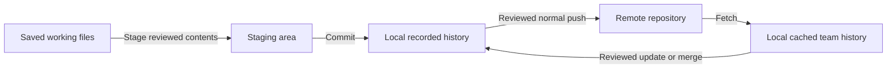
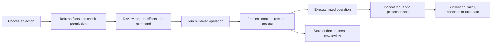

# GitCompass - Complete Functional Documentation

**Application:** GitCompass  
**Application baseline:** 0.1.1, Windows x64 internal portable trial  
**Document version:** 1.1  
**Prepared:** 13 October 2026  
**Primary audience:** People learning Git, developers, team leads and support staff  
**Implementation baseline:** The 13 October inspection update, with the original 12 October verification baseline retained separately

This manual describes the application that exists in this workspace. It explains the meaning of its controls, the conditions under which an action is permitted, the state it changes and how to inspect its result. It also identifies features that require external setup or further acceptance testing. A feature's presence in the source does not establish that every deployment or human workflow has passed.

The original build pack is a preserved planning reference. The source, current interfaces, verification records and this manual distinguish implemented behavior from the original requirements. This document does not authorize a Git action, a hosted submission or a permission change.

## Contents

- [1. Product, audience and scope](#1-product-audience-and-scope)
- [2. Essential Git concepts](#2-essential-git-concepts)
- [3. Installation and first launch](#3-installation-and-first-launch)
- [4. Your first practice session](#4-your-first-practice-session)
- [5. Application layout and shared context](#5-application-layout-and-shared-context)
- [6. Opening, discovering and switching projects](#6-opening-discovering-and-switching-projects)
- [7. Access modes and repository trust](#7-access-modes-and-repository-trust)
- [8. The reviewed-operation lifecycle](#8-the-reviewed-operation-lifecycle)
- [9. Overview and next-step guidance](#9-overview-and-next-step-guidance)
- [10. Changes, diffs, staging and unstaging](#10-changes-diffs-staging-and-unstaging)
- [11. Ignore suggestions and private files](#11-ignore-suggestions-and-private-files)
- [12. Saving a local version with a commit](#12-saving-a-local-version-with-a-commit)
- [13. Checking a remote with fetch](#13-checking-a-remote-with-fetch)
- [14. Updating a branch safely](#14-updating-a-branch-safely)
- [15. Uploading committed work with push](#15-uploading-committed-work-with-push)
- [16. History graph and branch comparisons](#16-history-graph-and-branch-comparisons)
- [17. Creating branches, switching and task intent](#17-creating-branches-switching-and-task-intent)
- [18. Integrating diverged histories](#18-integrating-diverged-histories)
- [19. Resolving conflicts and interrupted operations](#19-resolving-conflicts-and-interrupted-operations)
- [20. Preserving unfinished work with a stash](#20-preserving-unfinished-work-with-a-stash)
- [21. Starting history, cloning and ZIP migration](#21-starting-history-cloning-and-zip-migration)
- [22. Author identity and remote setup](#22-author-identity-and-remote-setup)
- [23. GitHub sign-in and pull requests](#23-github-sign-in-and-pull-requests)
- [24. Offline learning and command reference](#24-offline-learning-and-command-reference)
- [25. Settings and defaults](#25-settings-and-defaults)
- [26. Periodic checks, notifications and quiet hours](#26-periodic-checks-notifications-and-quiet-hours)
- [27. Git Output and Problems](#27-git-output-and-problems)
- [28. The interactive terminal](#28-the-interactive-terminal)
- [29. Preparing support information](#29-preparing-support-information)
- [30. Persistence, privacy and application removal](#30-persistence-privacy-and-application-removal)
- [31. Supported boundaries and special states](#31-supported-boundaries-and-special-states)
- [32. Troubleshooting and recovery reference](#32-troubleshooting-and-recovery-reference)
- [33. Functional architecture and data contracts](#33-functional-architecture-and-data-contracts)
- [34. Development, deployment and environment](#34-development-deployment-and-environment)
- [35. Verification and acceptance status](#35-verification-and-acceptance-status)
- [36. Functional requirement map](#36-functional-requirement-map)
- [37. Glossary](#37-glossary)
- [38. Sources and documentation maintenance](#38-sources-and-documentation-maintenance)

## 1. Product, audience and scope

GitCompass is a native Windows desktop application that helps a user understand a Git project and choose a deliberate next action. It combines project inspection, an ordered recommendation plan, reviewed local Git operations, synchronization, recorded history, offline lessons, hosted GitHub collaboration and an optional real terminal.

The central question is: **What is happening in this project, and what changes if I choose this action?** The answer comes from observed Git state. The recommendation engine uses rules rather than an online AI conversation.

| Audience | Typical starting point | Main use of GitCompass |
| --- | --- | --- |
| A person completely new to Git | Uses ordinary folders, ZIP copies or Google Drive | Learn the differences between editing, staging, saving a commit and uploading; inspect a disposable project first. |
| A developer learning team Git workflows | Can edit code but is unsure about branches, incoming work or conflicts | Review the current branch, preserve work and separate a remote check from integration. |
| A developer comfortable with basic Git | Wants a visible, reviewed daily workflow | Inspect diffs and ancestry, review destinations and use an explicitly unlocked terminal when needed. |
| A team lead or administrator | Supplies the canonical repository, branch rules and GitHub App setup | Explain authorized destinations, organize a pilot and assess deployment acceptance. |
| A support person | Needs the failure context without receiving project contents | Inspect attributed operation output and a user-reviewed local diagnostic bundle. |

The intended daily journey is to open a project, inspect its state, check team history when permitted, review changed contents, save a version locally, integrate incoming work if necessary, and separately upload the reviewed commits.

This build provides one integrated WPF shell. It is an unsigned internal trial, not a signed installer or a fully accepted production release. It does not automatically merge a pull request, force-push over team history, publish unstaged files, upload diagnostics or turn a ZIP's file dates into Git history.

## 2. Essential Git concepts

### 2.1 Four places your work can exist

| Place | What it contains | What changes it |
| --- | --- | --- |
| Working folder | Files currently saved on disk | Your editor, a reviewed update/switch/merge, or terminal commands. |
| Staging area, also called the index | Selected file contents intended for the next commit | Stage and unstage operations. |
| Local history | Commits saved in your local repository | Commit and reviewed history integration. |
| Remote repository | Published commits in a separately configured repository | A successful push or another person's publication. |

Unsaved editor buffers are outside these four recorded states. GitCompass reads saved files, so save your editor buffers before reviewing content.



**Cached team history** is a local record of the remote's history from an earlier fetch; it is not a live view of the server. A reviewed update or merge integrates that committed history into the current local branch and updates the checked-out files and index as appropriate. Fetch alone leaves the current branch and working files unintegrated.

### 2.2 The actions beginners most often confuse

| Action | Plain meaning | Files in your working folder | Online publication |
| --- | --- | --- | --- |
| Inspect / refresh local status | Read what Git knows locally | Not changed by the inspection | None |
| Stage | Select the current saved contents for the next local version | Preserved | None |
| Unstage | Remove selected paths from the next local version | Preserved | None |
| Commit | Save the reviewed staging area as a local recorded version | Usually unchanged by the commit itself; configured hooks may run | None |
| Fetch | Retrieve remote objects and refresh permitted cached remote references | Not integrated into the current working files | None |
| Update | Apply a reviewed behind-only target to the current branch | Can change | None |
| Merge | Integrate another reviewed committed history | Can change or conflict | None |
| Push | Publish committed history to the reviewed destination | Unstaged contents are not uploaded | Yes |
| Pull request | Ask for hosted review and a proposed merge | Does not download or integrate files | Creates a hosted collaboration record |

Generic Git pull can fetch and integrate in one command. GitCompass's guided path separates **Check remote (Fetch)** from reviewing an update or integration choice. See the official [fetch](https://git-scm.com/docs/git-fetch) and [pull](https://git-scm.com/docs/git-pull) manuals for Git's general command behavior.

### 2.3 A concrete content example

Suppose `welcome.txt` contains version A. You stage it, then edit the saved file into version B. The staging area still contains A until you stage again. A commit records the staging area, so it records A. The later working edit B remains outside that commit.

A file can therefore appear in both **Staged contents** and **Unstaged and new files**. The two rows represent different content states, not an accidental duplicate. A push publishes saved commits; it does not replace that selection with the latest file in your editor.

### 2.4 Git and GitHub

Git is the version-control system used locally and over configured transports. GitHub is a hosting and collaboration service. GitCompass's local status, history, guidance and lessons work without a GitHub account. Git fetch/push authentication and GitHub API sign-in are separate connections.

## 3. Installation and first launch

### 3.1 Running the portable trial

1. Obtain `GitCompass-0.1.1-win-x64.zip`.
2. Extract the complete archive into a writable folder.
3. Keep `GitCompass.exe`, its DLLs, `assets`, `terminal` and notices together.
4. Launch `GitCompass.exe` yourself.
5. Read the first screen and start with **Learn** or **Select project folder**.

The package contains its .NET/WPF runtime. Users do not need Visual Studio, VS Code, the .NET SDK or Node.js to run it. Git for Windows remains a separate prerequisite. Microsoft WebView2 Evergreen Runtime is required for the embedded terminal renderer.

| Prerequisite | Purpose | Behavior if unavailable |
| --- | --- | --- |
| Windows x64 | Runs the produced native desktop package | Other architectures and the company's specific OS matrix require separate acceptance. |
| Git for Windows | Provides the real Git command-line engine | The app displays setup guidance and a Git executable setting; project inspection cannot proceed. |
| WebView2 Evergreen Runtime | Renders the local terminal UI | Terminal initialization can fail and report a problem; missing-runtime deployment acceptance remains open. |
| Network and authorized transport credentials | Remote checks, clone, push and hosted APIs | Local inspection and lessons remain usable; remote operations can fail or remain unknown. |
| Registered GitHub App client ID and authorization | Hosted pull-request features | Local Git remains usable; the Pull requests page explains the missing setup. |

Use the official [Git download](https://git-scm.com/downloads/win) and [WebView2 distribution guidance](https://learn.microsoft.com/en-us/microsoft-edge/webview2/concepts/distribution) for prerequisites. GitCompass does not silently install or replace them.

### 3.2 What first launch does

Startup loads local preferences, offline learning content and the recent-project list. When Git is available, it creates the local workspace engine and reads the installed Git command inventory. It displays the no-project welcome state.

Merely launching the normal app does not choose a recent project, initialize a repository or grant access to write to a project. Opening a recent project remains a deliberate choice. Monitoring needs an explicitly opened, trusted and permitted project with monitoring enabled.

### 3.3 Setup recovery

If Git cannot be found, open **Settings → Advanced connection setup**, set the actual `git.exe` path, save and restart. The executable selection changes local preferences; it does not install Git.

If settings cannot be parsed or their schema is unsupported, the original file is preserved. **Preserve damaged settings and use reviewed defaults** copies it to a separate recovery file before allowing reviewed defaults to be saved. Do not interpret this as an automatic migration of an unknown settings format.

## 4. Your first practice session

Two practice options exist and have different starting states.

| Option | Initial contents and history | Intended use |
| --- | --- | --- |
| Prepared workspace fixture | `artifacts/GitCompass-Practice` has one local commit, modified `welcome.txt`, new `ideas.txt` and no remote | Inspect a working repository in Read-only immediately. |
| **Learn → Create a separate practice folder** | Creates a new temporary folder containing `practice.txt`; it initially has no Git history | Learn deliberate initialization and the first-commit journey. |

In this workspace, the prepared folder is `F:\Dev\Projects\GitCompass\artifacts\GitCompass-Practice`. It is separate from the application ZIP.

Recommended first exercise:

1. Read the daily journey in **Learn**.
2. Select the prepared practice folder.
3. Confirm its displayed project path and **Read-only** mode.
4. Open **Changes**. Inspect the modified and new files.
5. Open **History graph**. Identify the one recorded local version.
6. Explain why `ideas.txt` is visible in Changes but absent from that old commit.
7. Leave write access disabled for this first inspection.

To continue practicing local saving, deliberately select **Allow changes**, review the trust explanation, stage only the intended file, inspect the staged diff, write a message and run the reviewed local commit. Verify a new history entry. The prepared project has no upload destination, so no push is part of this exercise.

The source script `scripts/create-practice.ps1` can prepare another checkout's fixture. It refuses to overwrite an existing practice folder. The in-app practice button instead creates a uniquely named folder under the Windows temporary directory.

## 5. Application layout and shared context

The window has a persistent navigation sidebar, a project header, a main content area and a resizable lower dock.

| Area | Controls or information | Meaning |
| --- | --- | --- |
| Navigation | Overview, Changes, History graph, Branches, Pull requests, Learn, Settings | Selects the current page. |
| Project selector | Recent-project entries | Opens and inspects the chosen folder; does not silently switch a terminal's working directory. |
| **Select folder** | Native folder picker | Lets you choose one project folder. Canceling the picker does not open another folder. |
| Branch context | Branch name, Detached HEAD or No commits yet | Identifies the current checkout state. |
| Access selector | Read-only, Monitor only, Allow changes | Controls GitCompass's capabilities for this project/session. |
| Project path | Resolved root, plus selected folder when different | Helps distinguish a subfolder selection from its containing repository. |
| Freshness label | Last successful remote check, stale indication or not checked | Describes remote knowledge separately from the latest local inspection. |
| **Check remote** | Reviewed fetch path | Requires permitted access; refreshes cached team information. |
| Banner | Result, failure or team-update notice | Provides current context; a notice can offer an affected-project navigation action. |
| Lower dock | Git Output, Problems, Terminal | Keeps activity, actionable failures and real shell sessions separate. |

The lower dock can be resized with its splitter. Page content and output areas scroll independently. Content below the first visible portion of a page is still part of that page.

## 6. Opening, discovering and switching projects

### 6.1 Repository discovery

Opening a folder resolves the actual repository root and shared Git metadata identity. The engine distinguishes:

| Repository kind | User-visible implication |
| --- | --- |
| Candidate folder | No repository exists in that exact selected location. Initialization or clone is a separate reviewed action. |
| Working tree | Normal editable Git project with local metadata. |
| Linked worktree | A separate checkout sharing common Git metadata with another worktree. |
| Bare repository | Git storage without an ordinary checked-out working folder; guided working-project operations are unavailable. |
| Invalid metadata | Setup cannot be safely understood; review the reported problem before a guided operation. |

Selecting a subfolder inside a repository does not create a new nested repository. GitCompass shows the actual root. Guided initialization is rejected when the folder already belongs to a repository.

A candidate folder shows **Not using Git** in the header. Changes, History graph, Branches and Pull requests each explain what is unavailable and offer **Review ways to start using Git**, learning and folder selection. Remote checks and periodic monitoring are unavailable there, including in Monitor only. Opening setup preserves the files; initialization and clone still need Allow changes and a reviewed operation. GitCompass is not a general file editor or a backup system for ordinary folders.

A working Git repository without a remote or GitHub integration remains useful for local history, branches, diffs and reviewed local commits. Unknown team comparisons do not mean zero incoming or outgoing commits. A remote can be configured separately when online collaboration is wanted; GitHub API sign-in is not a prerequisite for local Git work.

### 6.2 Opening and refreshing

Opening loads a snapshot, reads real history, remembers the selected folder and displays Overview. Initial registration defaults to Read-only. Opening the same registered project again within the current session retains that registration's current session state.

The desktop attempts local refresh about every eight seconds when ready, not busy, not closing and not holding an operation review. Returning focus to the window also attempts local refresh when appropriate. This is local inspection, not periodic fetch.

An external editor or Git tool can change the repository between refreshes. The execute path rechecks actual evidence even when the visible page has not refreshed.

### 6.3 Recent projects and switching

Recent projects retain the canonical folder, display name and last-opened time. The stored list contains at most twenty entries and deduplicates paths case-insensitively.

Changing the selected project resets history comparison selections, paging and the transient previous-project banner. Retained operation events and Problems keep their originating project identity. A Problem's action can reopen that originating project before showing its output or support context.

Terminal tabs retain their original project and starting root. Project switching does not retarget them. A shell can itself change directory, so its current prompt also matters.

### 6.4 Shared metadata

Two linked worktrees can share one common Git directory. GitCompass coordinates managed operations by that shared identity rather than treating the checkouts as completely independent. Active terminal ownership can block a managed operation in another checkout sharing that metadata.

This coordination covers GitCompass-owned work. It cannot lock out all other editors, scripts or Git clients on the computer.

## 7. Access modes and repository trust

### 7.1 Capability matrix

| Capability | Read-only | Monitor only | Allow changes |
| --- | --- | --- | --- |
| Open project and inspect status/history/diffs | Yes | Yes | Yes |
| Read lessons, preferences and visible output | Yes | Yes | Yes |
| Prepare and save reviewed local support information | Yes | Yes | Yes |
| Fetch through the managed coordinator | No | Yes, after trust/setup | Yes, after trust/setup |
| Hosted GitHub reads | No | Yes, with authorization/setup | Yes, with authorization/setup |
| Initialize or clone | No | No | Reviewed operation |
| Stage, unstage, commit or modify ignore rules | No | No | Reviewed operation |
| Configure project author/remote | No | No | Reviewed operation |
| Update, merge, recover a supported merge or push | No | No | Reviewed operation |
| Create/switch branches or stash/restore | No | No | Reviewed operation |
| Create or input to a real terminal | No | No | Explicitly permitted session |
| Create a hosted pull request | No | No | Separate reviewed submission |

Read-only prevents GitCompass's repository mutations and network checks. It does not prevent the app from remembering a folder, saving preferences or writing its local redacted activity logs outside the project.

### 7.2 Why Monitor only is separate

Fetch changes local Git objects and remote-tracking metadata. That makes it different from strict local Read-only inspection, even though it does not integrate new files into the current branch.

### 7.3 Trust review

Before granting a non-Read-only mode to an untrusted registration, the app explains repository configuration and asks for a trust decision. Git transports and credential helpers may run during network work. With Allow changes, configured hooks and filters may also run during guided writes.

Trust is a user judgment about the project origin and configuration. It is not established merely by recognizing a folder name, choosing a Git executable or signing into GitHub.

The preview command is teaching text. Execution uses typed process arguments, not arbitrary command text copied out of the preview.

### 7.4 Session boundaries and downgrades

Allow changes is session-scoped and is not restored as an unrestricted grant after a restart. Current project monitoring and task intent are also held in the workspace session rather than the recent-project file.

When access is reduced:

1. The access generation changes, invalidating prior permissions and queued reviewed work.
2. App-owned active leases receive cancellation.
3. A pending transition is shown while owned activity closes.
4. New capability requests and terminal input are blocked while the transition is pending.
5. The stricter mode completes after the active leases are released.

If active shells or operations exist, the UI explains the consequences and asks whether to proceed. Closing a shell can stop its child processes. Reducing access does not promise that a started operation made no progress.

### 7.5 Boundaries of the permission system

The selector governs GitCompass. It is not a Windows filesystem sandbox, a restriction on other editors or a guarantee about arbitrary commands run in an unlocked shell. A terminal has the normal permissions of the Windows user and can leave its starting directory.

## 8. The reviewed-operation lifecycle

### 8.1 From intent to verified result



Selecting a **Review ...** action normally prepares an operation review. It does not perform that write. The review shows the project, branch, access, exact targets, effects and underlying command meaning.

Some previews also query the actual remote destination to validate publication safety. A preview can therefore involve a permitted network read before a push is executed; it is not a promise that no network access occurs during review.

### 8.2 What a review is bound to

The coordinator records the observed snapshot, content fingerprint, access generation, reviewed HEAD/upstream and exact targets. Commit reviews also bind the staging area's contents.

Before execution, the app checks that the review was issued by this workspace and has not been used, acquires the appropriate ownership, refreshes state, compares evidence and revalidates operation conditions. A changed file, index, branch, configuration, remote target or access grant can invalidate the review.

There is no blanket promise that a preview remains valid for a fixed number of minutes. Remote-dependent actions have a separate freshness condition.

### 8.3 Controls

| Control | Effect |
| --- | --- |
| **Run reviewed operation** | Attempts the exact reviewed operation after execution-time checks. |
| **Cancel review** | Returns to the page without executing that reviewed write. |
| **Cancel running operation** | Requests cancellation of the app-owned active work; it does not rewind Git effects. |
| Navigate away from a review | Changes the visible page; do not interpret this as a verified rollback of a running operation. |

### 8.4 Result states

| State | Meaning | User response |
| --- | --- | --- |
| Queued | Waiting to begin or obtain ownership | Wait; a permission change may prevent it from starting. |
| Starting | Conditions are being checked and execution prepared | Read the operation context. |
| Running | Git or a hosted adapter is active | Inspect live output; avoid concurrent external changes. |
| Succeeded | The operation completed and its applicable checks passed | Inspect the refreshed project and any operation-specific confirmation. |
| Failed | A reported failure stopped the requested path | Read Problems and output; preserve existing work. |
| Canceled | Cancellation was reported before a confirmed completed result | Refresh before deciding whether to retry. |
| OutcomeUnknown | Progress may have occurred or the expected result could not be confirmed | Inspect local state and, where relevant, the actual remote before retrying. |
| Denied | Access or authorization is insufficient or was revoked | Review the intended capability and grant; do not reuse the old review. |
| Stale | Reviewed evidence or targets no longer match | Refresh and create a new review. |

A successful process exit is not enough for all operations. Commit verification checks the reviewed index, branch and immediate ancestry; push verification checks the actual destination version. Hooks or an interrupted connection can lead to OutcomeUnknown.

## 9. Overview and next-step guidance

The following captured screen is from a disposable test repository in Read-only. Its sample counts illustrate the interface, not the state of your own project.


### 9.1 Observed facts

Overview separates changed file paths, team-only commits and local-only commits.

| Fact | Interpretation | Common mistake to avoid |
| --- | --- | --- |
| Changed files | Saved work differing from staged/recorded state, including new paths | Treating the count as a count of new commits. |
| Team-only commits | Commits in the cached upstream not reachable from the current local branch | Assuming the server was checked just now. |
| Local-only commits | Commits in the local branch not present in the cached upstream comparison | Assuming that cache is the exact push destination. |
| Unknown comparison | No reliable upstream/commit comparison is available | Replacing unknown with zero. |
| Last successful upload in this session | A reviewed commit was confirmed at an explicit URL/branch | Treating it as a fresh fetch result or an upload of all working files. |

### 9.2 User goals

The goal selector offers **Understand this project**, **Upload my work**, **Get the latest changes**, **Start a task**, **Prepare a pull request** and **Understand this error**.

Goals affect recommendations, not permissions. Choosing Upload my work does not push. Choosing Get the latest changes does not authorize integration.

### 9.3 Recommendation ordering

The engine first prioritizes an interrupted operation or unmerged paths. It then handles unsupported setup, a candidate folder and Detached HEAD. For an ordinary attached branch, the plan can include task-branch intent, preserving local changes, a first commit, missing tracking, incoming/outgoing/diverged history, shallow-history limits and a stale remote check.

| Situation | Typical guidance | Condition before proceeding |
| --- | --- | --- |
| No repository | Start version history or clone deliberately | Exact folder and origin reviewed. |
| Active operation/conflicts | Finish the recorded operation | Understand the operation and resolve paths. |
| Detached HEAD | Attach work to a named branch | Review the exact base commit. |
| Local changes | Review and save changed files | Save editor buffers; inspect both staged and unstaged contents. |
| No upstream | Choose the connection | Obtain the authorized remote and branch. |
| Behind only | Review incoming commits | Fresh relevant remote check and a safe clean state. |
| Ahead only | Review outgoing commits | Review the actual push destination. |
| Ahead and behind | Review both histories | Preserve work and review integration. |
| Equal cached histories | No known commit synchronization needed | Still consider unsaved/local work and cache age. |

Each recommendation can expand **Explain this step**, showing its effects, prerequisites, recovery advice and lesson link. Recommendations are deterministic guidance based on observed facts; they do not infer a team's branch policy.

## 10. Changes, diffs, staging and unstaging


### 10.1 File groups

**Unstaged and new files** contains work outside the next staged version. **Staged contents** contains selected contents currently in the index. Readable labels include Modified, New file, Deleted, Renamed, File type changed and Conflict.

If a staged file is edited again, its label explains that some contents are selected and further edits are not selected. Exact Git codes and an original rename path remain available in row details/tooltips.

### 10.2 Inspecting a diff

Select a path to inspect its working or staged diff according to the group. New untracked files are shown as saved file contents when suitable. Selecting a commit in History instead shows that recorded commit's changes.

The managed diff viewer suppresses external diff and text-conversion drivers. It has a bounded output of approximately 256 KiB and labels truncation. Binary/untracked content is summarized rather than presented as a meaningful text diff. A linked untracked file is identified without reading its external target.

The viewer is an inspection aid. It is not a general file editor, a binary merge tool or a full large-file comparison system.

### 10.3 Staging

**Where:** Changes → select paths under Unstaged and new files → **Review staging selected files**.  
**Access:** Allow changes and trusted configuration.  
**Inputs:** One or more exact displayed paths.  
**Effect:** Adds those saved contents, including reviewed deletions, to the index.

1. Save the relevant files in your editor.
2. Inspect each intended diff.
3. Select the exact files; extended selection supports multiple paths.
4. Review the displayed paths and operation.
5. Run the reviewed operation.
6. Reinspect Staged contents.

The app does not substitute a broad `git add .` for the selected paths. It rejects paths that are not in the reviewed change list and guided staging of changed submodule paths. Existing staged contents remain in the index.

### 10.4 Unstaging

Select paths under Staged contents and choose **Review unstaging selected files**. The operation removes those paths from the next commit while preserving working files. For a branch with history, it restores that index selection from the reviewed HEAD; before the first commit, it removes the selected cached entries.

Unstaging is not deleting a file and is not discarding an edit. This UI does not offer a blanket discard/reset button.

### 10.5 When a selection becomes stale

If another tool changes a selected file or the staging area after review, execution is refused as stale. Reopen the review from current facts. The application deliberately favors a fresh selection over running an earlier assumption.

## 11. Ignore suggestions and private files

**Where:** Changes → **Review ignore suggestions**.  
**Access to inspect suggestions:** Local inspection.  
**Access to apply:** Allow changes and a reviewed operation.

Suggestions use visible project markers:

| Detected marker | Suggested patterns |
| --- | --- |
| `.csproj`, `.sln` or `.slnx` | `bin/`, `obj/`, `.vs/` |
| `package.json` | `node_modules/` |
| `pyproject.toml` or `requirements.txt` | `__pycache__/`, `.venv/` |
| General private-settings precaution | `.env` |

Each suggestion explains its reason and lists matching untracked paths. Matching paths already tracked by Git are listed separately because adding an ignore rule does not untrack them. The screen shows a bounded sample of affected paths.

Applying chosen rules appends them while preserving existing comments/rules. Existing contents are backed up outside the project under the GitCompass local application-data ignore-backup directory. A linked `.gitignore` is rejected for this edit path.

The operation changes `.gitignore` on disk. It does not automatically stage that file, remove a tracked credential, rewrite old commits or delete generated output.

Suggestions are aids, not comprehensive secret detection or a complete emulator of every nested/global/negated ignore rule. Review private configuration, credentials, generated output and large assets separately. The original specification's deeper native ignore variants remain acceptance items.

## 12. Saving a local version with a commit

**Where:** Changes → **Write commit message** → **Review local commit**.  
**Access:** Allow changes.  
**Required facts:** Staged contents, no unresolved conflicts, an author identity and a nonempty valid message.

1. Inspect the entire Staged contents group.
2. Remember that pre-existing staged paths are also included.
3. Write a message explaining what changed and why.
4. Review the local commit and its full staged target list.
5. Run it.
6. Inspect History graph and the remaining Changes.

The UI records the whole reviewed index, not merely the last highlighted file. It uses configured author, hooks and signing settings. A signing or hook failure can block a commit.

After a successful result, expect a new local commit with a new identity and the intended contents. A file edited after staging can still have unstaged changes afterward. No upload occurs as part of committing.

The verifier compares the resulting committed content with the reviewed index and checks the current branch and immediate parent. If a hook changes the branch, ancestry or contents, the app can report OutcomeUnknown even when Git returned success.

For an empty-stage error, stage intended contents first. For an identity error, use Remote and author setup. For a hook/signing error, inspect its output and configured tools; do not disable them blindly.

## 13. Checking a remote with fetch

**Where:** Project header → **Check remote**, or the relevant Overview recommendation.  
**Access:** Monitor only or Allow changes, plus repository trust.  
**Required setup:** A valid configured remote; the current branch's tracking remote is used when one can be resolved.

A manual check prepares a review. The scoped execution retrieves objects and updates the chosen remote's `refs/remotes/<remote>/...` namespace and `FETCH_HEAD`. It does not integrate working files, advance local branches or publish commits.

GitCompass overrides configured fetch mappings for this path and disables automatic tag/prune-tag, submodule-recursion, maintenance and commit-graph side effects. Pruning can remove stale remote-tracking references in that permitted namespace when their remote branches no longer exist.

After success, the app records the relevant remote and a last-success timestamp and refreshes the project. After failure or uncertainty, cached facts remain visible but must not be used as a fresh success.

If no tracking remote can be resolved, the app does not assume `origin`. Use project setup to review the authorized connection. A branch that is configured but missing remotely yields an unknown comparison requiring investigation, not an automatic replacement branch.

Fetch can invoke the repository's transport or credential helper. The managed process is noninteractive for ordinary terminal prompts; configure Git's authorized credential or SSH path outside the app as needed. GitHub API sign-in does not repair Git transport authentication automatically.

## 14. Updating a branch safely

The guided Update path is a reviewed fast-forward of a behind-only branch to its exact fetched target.

| Preconditions | Why required |
| --- | --- |
| Attached local branch with recorded HEAD | The operation needs a known current branch. |
| Known readable upstream target | Unknown tracking cannot supply a safe target. |
| No local-only commits and at least one team-only commit | The simple path is not a divergence decision. |
| Clean reviewed worktree/index/change list | Local work must be preserved first. |
| Successful check of the relevant remote within ten minutes | Different-remote, failed or old observations are insufficient. |
| No active operation or unresolved paths | Existing recovery takes priority. |

1. Check the remote.
2. Inspect incoming history.
3. Preserve all local staged, unstaged and relevant untracked work.
4. Review the update target.
5. Run the update.
6. Inspect the changed files and refreshed HEAD.

The managed command uses a fast-forward-only merge and protects ignored-file collisions. Untracked or ignored files that would be overwritten can block the action. GitCompass does not silently stash, overwrite or choose a force update.

Success is checked against the reviewed target identity. If a target or repository fact changed after review, create a fresh review.

The ten-minute rule is an execution precondition. It should not be confused with a guarantee that every header label automatically changes exactly at that time.

## 15. Uploading committed work with push

### 15.1 What is reviewed

The managed push resolves one actual push URL, one source branch and one destination branch. The review distinguishes the actual server destination from the cached upstream used for ahead/behind counts.

The app queries the destination's current commit. If that server commit is unknown locally, or contains history not safely included in the local branch, publication is blocked until the relevant remote is checked and integration is reviewed.

Ambiguous, forced or multiple configured mappings are not accepted as one safe destination. Multi-step URL rewriting that changes the reviewed actual target is rejected. The write executes against the reviewed URL directly with one explicit branch refspec.

### 15.2 Workflow

**Access:** Allow changes.  
**Required facts:** Attached branch, a local commit, one valid destination, trusted setup and a fresh successful check of the relevant remote.

1. Commit the intended staged contents locally.
2. Check the relevant remote.
3. Inspect its actual destination and outgoing saved history.
4. Review source branch, URL, destination branch and expected server state.
5. Run the reviewed normal push.
6. Read the publication confirmation.
7. Fetch again when you need refreshed cached comparisons.

The app offers no guided force-push substitute. A normal server race can be rejected or make the old review stale. Read the result and review current history.

### 15.3 Confirmation and uncertainty

After an apparently successful push, the engine reads the actual destination reference and checks that it points to the reviewed commit. Only then can it report verified publication.

For first publication, local tracking keys are set after destination verification. If publication succeeded but tracking setup did not finish, the result can be uncertain; review tracking rather than blindly repeating the upload.

Overview retains the last successful upload evidence for the session: commit, URL, branch and time. Cached team-only/local-only counts may still describe the earlier fetch or another upstream. An unchanged ahead count immediately after a verified push does not prove that the publication failed.

If interrupted after a possible remote acceptance, inspect the actual server before retrying. That distinct fault-injection acceptance variant is still open even though general cancellation and destination-verification behavior have tests.

## 16. History graph and branch comparisons


History graph displays real recorded commits and parents. Working edits do not become invented graph nodes.

| Element | Meaning |
| --- | --- |
| Circle/row | A real saved commit. |
| Parent line | Recorded ancestry relationship. |
| Branch/ref label | A name currently pointing to a recorded version. |
| Dotted continuation | A parent outside the loaded page or hidden by filtering. |
| Local branch | A branch in the local repository. |
| Fetched copy | Last locally recorded remote-tracking history, not a live server view. |
| Shallow-history notice | Earlier ancestry may not exist locally. |

Selecting a row shows its message, full commit identity, parents, author/date and bounded recorded diff. Accessible row text also includes exact identities and parents.

### 16.1 Comparing branches

Choose **First branch** and **Second branch**, then **Compare selected branches**. Choices come from the current branch inventory and are bound to actual commit identities. The view reports commits only on the first side and only on the second.

**Show current branch and team copy** returns to the default HEAD/upstream relationship.

Comparison is an inspection feature available in Read-only. It does not create a branch, merge history or perform a network check.

### 16.2 Filtering and paging

The text filter searches the loaded page's message, author, branch-label information and commit identity. It is case-insensitive. It is not a repository-wide history search.

The desktop loads at most two hundred rows per page. Previous/Next controls are available when appropriate. Paging retains its anchor; changed references can refresh the first page or require a new selection rather than silently splice two different histories.

A filter can hide the displayed endpoint of a parent line. The line does not imply that the remaining visible rows acquired a new parent relationship.

## 17. Creating branches, switching and task intent

The Branches page lists local branches and fetched remote copies in Read-only, Monitor only and Allow changes. Select a row and choose **View selected branch history** to inspect only that branch's recorded ancestry. This reads local commits at the selected exact tip; it does not check out that branch, fetch, change the index or edit working files. The History graph states which branch is being viewed and which branch remains checked out. **Show current branch and team copy** restores the usual relationship view. A fetched branch reflects an earlier remote check, not a live server query.

If the selected tip changes before it can be validated, refresh the inventory and choose it again. Missing partial-clone objects are reported as unavailable: inspection disables Git's implicit lazy fetch. This process-scoped safeguard prevents a read action from silently retrieving missing repository objects.

### 17.1 Creating a branch

**Where:** Branches → **New branch name** and **Base commit or branch** → **Review creating branch**.  
**Access:** Allow changes.  
**Effect:** Creates a new local name at the exact reviewed base commit.

Creation and switching are separate actions. Creating a branch does not move the current checkout or change working files. The engine rejects invalid names and existing branch names.

For a detached checkout, a named branch can preserve a deliberate base. Select the new local branch and review switching when you want to attach the checkout to it.

### 17.2 Switching

Select an existing local branch and choose **Review switching to selected local branch**. The guided path requires a clean reviewed state and checks the exact target commit. It does not guess a remote-tracking branch or create a matching local branch implicitly.

Switching can change checked-out files. Untracked/ignored collision protection can block it. Preserve unfinished work before switching.

This build does not expose guided branch deletion, rename, arbitrary history rewriting or force movement of an existing branch.

### 17.3 Task intent

**Intended branch for this task (optional)** lets you tell the app which branch the task belongs on. **Save task branch intent** stores that session intention; it does not switch branches.

The engine warns about a wrong branch only when this intention has been explicitly configured. It does not infer the correct branch from a folder name or assume that every team uses `main`.

## 18. Integrating diverged histories

Divergence means both sides have committed versions absent from the other side. A behind-only fast-forward is therefore insufficient.

1. Preserve local edits.
2. Check the relevant remote.
3. Compare the two histories and shared ancestor.
4. Open **Review integration options**.
5. Inspect the current branch, fetched upstream and exact target.
6. Choose **Preview merge of fetched upstream**.
7. Run only the reviewed merge you intend.
8. If it completes, inspect and test the project before publishing.
9. If it conflicts, follow the conflict workflow.

The guided shared-history path merges the reviewed committed target. It requires a clean state, a current attached branch, fresh remote evidence and a known common ancestor. Unrelated histories are not automatically combined.

The preview explains the merge and binds the target. It is not a promise that all conflicts have been predicted or that a full native conflict editor is provided.

The app does not automatically select ours/theirs, rebase the branch, discard a side or force-push. Other integration policies require a team-approved external or terminal workflow.

## 19. Resolving conflicts and interrupted operations

### 19.1 Recognizing the state

The snapshot recognizes recorded Merge, Rebase, CherryPick, Revert and Bisect operations, and also unmerged paths without one of those recorded states. Ordinary guided operations stop while recovery is unresolved.

The guided Continue/Abort buttons support a recorded merge. Other recorded operation types remain visible but need the normal editor or developer-guided Git recovery tools.

### 19.2 Resolve a merge conflict

1. Read the interrupted-operation context and conflicted path list.
2. Use **Reveal file in Explorer** to select an affected file.
3. Open it in your chosen editor and decide the intended result.
4. Inspect both sides where needed. Binary and rename/delete conflicts can require developer assistance.
5. Save the resolved file.
6. Choose **Review resolved file** and stage that exact resolution.
7. Repeat for every unmerged path.
8. Review **continuing the merge**.
9. Inspect the completed history and project before upload.

Revealing uses a fixed Windows Explorer executable and validated relative path. It does not launch an arbitrary project file according to its extension.

### 19.3 Continue or abort

**Review continuing the merge** is available only for a recorded merge with no remaining unmerged paths. It commits the whole reviewed index using the recorded merge message.

**Review aborting the merge** applies only to the recorded merge. Git attempts to restore the earlier state; edits made during resolution need inspection. Abort is not a universal backup.

### 19.4 Stash-apply conflicts

A stash apply can create unmerged paths without `MERGE_HEAD`. The app still blocks ordinary operations, preserves the exact stash and allows deliberate inspection/staging of resolutions. A missing recorded merge does not mean the project is conflict-free.

Do not use Continue merge for a non-merge stash conflict. Resolve and inspect the restored contents, then use the appropriate deliberate local workflow.

## 20. Preserving unfinished work with a stash

**Where:** Changes → **Preserve work with a stash**.  
**Access:** Allow changes.  
**Purpose:** Save unfinished tracked edits locally so another reviewed operation can proceed.

The default choice preserves tracked staged and unstaged work. **Include untracked files** adds that explicit inclusion. Ignored files remain outside the stash.

The managed stash covers the eligible project work; this UI is not a partial-hunk stash selector. It records the exact stash identity, not a fragile list position such as the latest ordinal.

### 20.1 Creating

1. Inspect what is unfinished and whether untracked contents should be included.
2. Review creating the stash.
3. Run it.
4. Inspect the clean or remaining worktree state.
5. Retain the displayed stash identity.

If untracked files were excluded, they can remain in the working folder and still block a clean-state update or switch.

### 20.2 Restoring

The UI offers **Review restoring this specific stash** for the app-created stash known in the current session. Restoration requires a clean state and applies that identity with its index state.

After apply, the stash is retained. GitCompass does not automatically drop it. Verify all intended contents and resolve any conflicts before deciding separately what to retain.

This session-specific control is not a full browser of every historical stash. After restart, the Git stash can still exist even though this UI's in-memory shortcut is no longer available; use normal developer-guided Git tools when needed.

## 21. Starting history, cloning and ZIP migration

### 21.1 Starting a new repository

For a candidate folder, Overview offers an **Initial branch** input and **Review initialization**. The suggested input is `main`, but the user chooses the authorized name.

Initialization creates metadata in that exact folder. It does not stage, commit or upload existing files. Review ignore rules, private configuration and local author identity before the first commit.

### 21.2 Cloning an existing repository

Choose a separate empty candidate folder. Enter the authorized **Repository URL**, then choose **Review clone into this empty folder**.

The exact destination must be empty. The app rejects cloning into the populated ZIP copy and does not merge unrelated files automatically. Clone downloads the repository into that folder; the managed path does not recursively initialize submodules.

Git transport authentication and trust still apply. A GitHub API token is not substituted for the Git transport's configuration.

### 21.3 Migrating a ZIP copy when a team repository already exists

1. Keep a dated copy of the ZIP-derived folder.
2. Obtain the team's canonical URL and branch policy.
3. Clone into a separate empty folder.
4. Compare the old files with the clean clone.
5. Copy only reviewed working changes into the clone.
6. Exclude Git metadata, private configuration and generated files.
7. Inspect, stage and commit those changes.
8. Check/integrate team history as appropriate.
9. Review a normal push to the authorized branch.
10. Verify a separate clean clone before retiring the backup.

Do not copy an old `.git` directory over the clean clone. A ZIP snapshot's timestamps do not reconstruct a trustworthy sequence of historic Git commits.

### 21.4 First publication to a chosen remote

For a truly new project, initialize deliberately, review ignores/files, configure your author, save a first local commit, configure the authorized remote/tracking choice, check it, and review **initial branch push**.

The final verification checks the destination commit. An existing remote with unrelated history requires migration review; this app does not replace that history to make first publication easy.

Creating a hosted GitHub repository itself is outside this UI's guided scope. Supply an authorized existing destination.

## 22. Author identity and remote setup

**Where:** Overview → **Remote and author setup**.

| Field/control | Meaning and validation |
| --- | --- |
| Commit author name | Your attribution for new commits; single-line input. |
| Commit author email | Your own single-line email-like value, including `@`; not a GitHub password. |
| Review author identity change | Writes only this repository's `user.name` and `user.email`. |
| Remote name | Explicit local connection name; `origin` is suggested, not assumed as policy. |
| Authorized repository URL | Destination supplied by you or the team. |
| Tracking branch | Optional; blank configures only the remote. |
| Review remote configuration | Adds the new remote and optionally the reviewed current-branch tracking keys. |
| Publication destination branch | Explicit branch for the initial push. |
| Review initial branch push | Separate publication review and verification. |

Author identity does not change past commits and does not alter global Git settings. GitHub sign-in does not fill it automatically.

Remote setup adds a new named connection. If that name already exists, the guided path refuses to overwrite it. Changing or removing an existing remote requires separate informed Git configuration work.

Adding a remote or setting tracking does not itself fetch or push. Confirm the configured connection through a separate permitted check.

## 23. GitHub sign-in and pull requests

### 23.1 Deployment setup and authentication

The current adapter targets `https://api.github.com` and uses API version `2026-03-10`. GitHub Enterprise-specific host configuration is not exposed in this build.

An administrator supplies a registered GitHub App's public **client ID**, enables device flow and grants appropriate access on the intended repositories. This is not the App ID, a user password, a private key or a client secret.

| Repository permission | Purpose in this adapter |
| --- | --- |
| Pull requests: write | Deliberate creation of pull requests. |
| Contents: read | Verify the published source branch's exact commit. |
| Checks: read | Read private check-run information when granted. |
| Normal metadata/repository access | Identify accessible repositories and requests. |

User access is also constrained by the user's own repository permissions. See GitHub's [user-token documentation](https://docs.github.com/en/apps/creating-github-apps/authenticating-with-a-github-app/generating-a-user-access-token-for-a-github-app).

### 23.2 Device sign-in

1. Save the public client ID in Settings → Advanced connection setup.
2. Open Pull requests and choose **Sign in to GitHub API**.
3. Read the verification address, temporary code and expiry.
4. Open the official sign-in page in your system browser.
5. Authorize the intended App and account there.
6. Return to GitCompass and read the sign-in result.

**Cancel sign-in** stops that authorization polling path. Switching projects cancels its active authorization attempt. Sign-in does not change the project's access mode and does not perform a Git fetch/push.

Tokens are held in current-user protected local storage. Refresh and device polling have controlled-response tests; a designated live registered-App pilot is still required.

### 23.3 Reading requests and status

Enter the **Target repository owner** and **Target repository name**, then choose **Read pull requests**. This hosted read requires Monitor only or Allow changes and valid authorization.

The open-request list shows number, title, source-to-target branch, state, draft/readiness and reported mergeability. **Read status, reviews, and checks** retrieves further details.

Enter a positive **Pull request number** to read a closed or merged request as well. Missing mergeability remains pending/unknown. Restricted reviews/checks are shown as unavailable, not passing. Empty returned lists do not invent successful reviews.

**Open pull request in browser** opens the returned HTTPS resource for the user. It is distinct from automatically performing a hosted merge.

The adapter reads bounded paginated lists of up to one hundred pages of one hundred records. An exhausted bound is an explicit incomplete-result error. Conditional caching preserves page continuation so a cached first page is not mistaken for the complete list.

### 23.4 Preparing a pull request

| Input | Required interpretation |
| --- | --- |
| Target repository owner/name | Repository receiving the review request. |
| Title and Description | Human explanation of the proposed change. |
| Source repository owner/name | Repository containing the published branch, including a fork with a different repository name. |
| Published source branch | Must match the current attached local branch for this guided path. |
| Target branch | Explicit destination branch; no team default is invented. |
| Create as draft | Enabled by default; distinguishes draft from ready review. |

Workflow:

1. Save the intended source commit locally.
2. Publish it to the explicit source repository/branch.
3. Enter target/source details and the request text.
4. Choose **Review pull request submission** with Allow changes.
5. The adapter verifies that the chosen published branch points to the current local HEAD.
6. Inspect the exact repositories, branches, verified commit, title, description and draft state.
7. Choose **Submit reviewed pull request**.
8. Access, local fingerprint and published source are rechecked before submission.
9. Read the created or matching-existing request result.

PR creation does not merge the branches or integrate files locally. A mismatch in source verification blocks submission.

### 23.5 Error and duplication handling

The adapter distinguishes missing sign-in, forbidden access, inaccessible resources, rate limits, validation failure, connectivity trouble and uncertain server outcomes.

Before creating, it looks for a matching existing request, including source repository identity. After an uncertain submission, it attempts reconciliation instead of blindly reposting. This uncertainty tracking belongs to the client's current session; after restarting, verify on GitHub before repeating an uncertain action.

This build does not provide guided review-comment submission, approvals, merge-button execution, request closure/reopening or repository administration. Those collaboration tasks use GitHub's normal tools.

## 24. Offline learning and command reference

Learn presents the daily journey first. **Find another lesson or command** expands task/concept/command search. A selected entry explains:

- Purpose.
- Prerequisites.
- What changes.
- When to pause.
- Example.
- Expected outcome.
- Practice.

The bundled manifest has 138 original lessons/reference entries covering 133 declared core commands. Those reference entries are educational coverage, not a statement that all 133 commands have guided buttons.

**View installed command inventory and reference coverage** compares the declared catalog with the installed Git help inventory. The recorded installation listed 153 commands: 128 declared matches and 25 explicitly unsupported entries; five declared commands were not listed by that help inventory. Missing from help does not prove an executable is unavailable.

Lessons and terminal JS/CSS ship locally. Local guidance and reading need no online AI or CDN. Examples are learning content; they are not automatically run by selecting a lesson.

## 25. Settings and defaults

| Setting | Default or allowed values | Persistence/effect |
| --- | --- | --- |
| Appearance | System; choices Light, Dark, System | Theme can preview immediately; Save settings persists it. |
| Remote check interval | Five minutes; allowed 1-1440 | Saved preference used by the scheduler. |
| Enable periodic remote checks for current project in this session | Off for a new registration | Available only for a working Git repository; applies to the current project/session and requires fetch permission. |
| Mute team-update notifications | Off | Saved; suppresses monitoring notices, not permitted checks. |
| Use quiet hours | Off | Saved start/end hours when enabled. |
| Quiet start/end | Different integers 0-23 in local time; UI suggestions 22 and 8 | Can span midnight; start is inclusive and end exclusive. |
| Git executable path | Blank means detection | Saved; changing the engine path requires restart. |
| Registered GitHub App public client ID | Blank | Saved non-secret connection setting. |
| Sign out of GitHub API | Action | Cancels sign-in and clears protected API credentials; Git transport credentials remain separate. |

**Save settings** validates numeric bounds and the quiet-hours pair. It preserves a damaged settings file until the explicit recovery copy has been made.

The advanced section includes the detected Git path and host/architecture information. It expands automatically when the Git workspace is unavailable.

Example: quiet hours 22 to 8 suppress notices from 22:00 through 07:59 local time. They do not turn Monitor only on and do not disable ordinary status or failure visibility.

## 26. Periodic checks, notifications and quiet hours

Periodic monitoring is active only while the app runs and the project is opened, trusted, explicitly monitoring-enabled and allowed at least Monitor only with no pending transition.

The scheduler uses the same reviewed coordinator for permitted fetches. Enabling a schedule authorizes those repeated scoped checks; it does not authorize repeated integration or publication.

Initial scheduling uses a small randomized delay. Subsequent checks use the chosen interval with jitter. Failures increase an exponential delay, capped at a multiplier of thirty-two. The loop checks schedules about every three seconds; these are implementation timings, not exact wall-clock guarantees.

Authentication/credential-related failures pause that project's checks. After repairing Git transport authentication, a successful manual check resumes its schedule. Other failures retain cached state and back off. Full connectivity/restored-authentication and notification-dedup timing remain acceptance variants.

Notices focus on meaningful incoming/diverged/missing-upstream changes rather than announcing every successful check. The current implementation displays in-app banners with **Open affected project** navigation. It does not provide an accepted system-tray/background-service/toast deployment.

Mute and quiet hours suppress these notices while allowed checks continue. They do not hide the project's status or managed operation errors. No notice automatically updates files or uploads work.

## 27. Git Output and Problems

### 27.1 Output channels

| Channel | Selection |
| --- | --- |
| Current project activity | Current project's retained app-managed events. |
| Git operations | Current project's non-fetch, non-hosted Git activity. |
| Remote checks | Current project's fetch activity. |
| All registered projects | Retained events across project registrations. |
| GitHub activity | Current project's hosted reads/writes. |

**Filter output** searches retained event text. State choices are **All states**, **Problems**, **Succeeded** and **In progress**. Problems includes failed, denied, stale and uncertain outcomes.

### 27.2 Display and copying

**Group by operation** shows expandable operation groups. Group headings carry purpose, project, final state, time and a short operation identity. Each group offers **Copy this operation**. Successful groups can start collapsed.

Turning grouping off shows selectable combined text. **Copy** uses selected text where present, otherwise the retained combined view. **Auto-scroll** follows visible output. **Clear view** advances the visible marker; it does not cancel a process, delete the repository or erase retained log files.

Output is bounded. Earlier text/events can be trimmed and marked as truncated. The desktop retains around ten thousand events before trimming earlier groups; text display and per-operation copies also have limits. Use filters and reviewed diagnostics when the view is too large.

GitHub activity records purpose and result labels, not token-bearing HTTP bodies, device codes or raw authentication responses.

### 27.3 Problems

Problems provides attributed failure cards with **Review operation output** and **Prepare reviewed support information**. Up to forty visible problem cards are retained. The origin is kept so switching projects does not turn another project's failure into the current project's problem.

An error display is not a recovery command. It explains where to inspect; the user still chooses the next action.

## 28. The interactive terminal

### 28.1 Creating and owning a session

Choose **Terminal → New PowerShell session** with Allow changes and trusted project configuration. The control is disabled in Read-only and Monitor only; its explanation points to Branches and History graph for safe inspection. The app refreshes the project and validates the working root. It can also use a valid candidate folder for a shell after deliberate access.

The terminal uses a real Windows ConPTY PowerShell session. Each tab has independent input/output, its originating project, its starting directory and owned child-process lifetime.

Active terminal ownership can block managed operations sharing the same Git metadata. Close those sessions before using the guided managed path. Local inspection and hosted-read exceptions remain subject to their own permission checks.

### 28.2 Controls

| Control | Function |
| --- | --- |
| New PowerShell session | Opens another owned shell with reviewed access. |
| Interrupt | Sends interruption to the active session; preserves a reusable shell where possible. |
| Copy selection | Copies terminal selection. |
| Paste | Sends reviewed clipboard text to the active shell. |
| Close session | Closes that session and owned children after the exit explanation. |

Multiline paste shows a review dialog because lines can execute immediately. Paste is limited to 64 KiB. Canceling the paste review sends none of that text.

### 28.3 Renderer and boundaries

The WebView2 renderer loads bundled xterm assets from a fixed local origin. External navigation/resources, new windows, downloads, browser permission requests and unrestricted host objects are blocked for that renderer.

This protects the renderer's bridge; it does not turn the PowerShell process into a safe command sandbox. Arbitrary shell commands still need the user's judgment and normal Windows permissions.

Terminal scrollback/render queues are bounded and can show truncation notices. Terminal output stays separate from managed Git Output and is excluded from support bundles. GitHub API tokens are not injected into its environment.

Changing projects does not reset a terminal directory. Downgrading access revokes input and closes owned sessions before the stricter mode completes. Closing the app stops its owned shells rather than leaving them silently active.

## 29. Preparing support information

**Where:** Git Output → **Prepare support view**, or a Problem's support action.  
**Prerequisite:** An opened project providing the context.

The support view shows project/branch/access, relevant Git version, last successful remote check and bounded redacted managed events. It presents two editable artifacts:

| Artifact | Contents |
| --- | --- |
| `summary.md` | Readable context and event summary. |
| `events.json` | Structured summary and events. |

1. Inspect every field and event.
2. Remove any remaining private information in both editors.
3. Choose **Copy reviewed summary** or **Save reviewed diagnostic bundle**.
4. For saving, choose a local folder.
5. The JSON must still parse; a timestamped uniquely named support folder is created.
6. Share it yourself only when appropriate.

The UI selects up to two hundred recent managed project events; the exporter has its own upper bounds. It excludes source contents, diffs, environment dumps, repository files and terminal scrollback.

Redaction recognizes common credentials/private paths and is best effort. Editing the readable summary does not automatically edit the separate JSON. Review both. Saving a bundle does not transmit it to another person or service.

## 30. Persistence, privacy and application removal

### 30.1 Storage map

The default application-state root is `%LOCALAPPDATA%\GitCompass`, outside the selected project.

| Location/state | Purpose | Important boundary |
| --- | --- | --- |
| `settings.json` | Schema-versioned preferences and non-secret connection settings | Credentials are not stored here. |
| `repositories.json` | Up to twenty recent folder records | Does not restore Allow changes or initialize those folders. |
| `credentials/github.bin` | Current-user Windows DPAPI-protected API token set | Another user/machine context may require sign-in again. |
| `logs/*.jsonl` | Redacted managed event records | Subject to bounded retention; not a repository backup. |
| `ignore-backups` | Original ignore-file contents before an app edit | Recovery aid, not complete project backup. |
| `webview/terminal` | WebView2 terminal profile/cache | Outside repository contents; separate renderer state. |
| Chosen support destination | User-reviewed diagnostic bundle | Saved only after folder selection. |
| Current-session memory | Access/trust, monitoring registration, branch intent, known stash shortcuts, upload confirmations and PR uncertainty | Do not assume these survive a restart. |

Normal settings/recent writes use a temporary file and replacement. Unsupported or malformed JSON is preserved rather than silently overwritten as a successful load.

Log cleanup occurs during writes. It removes records older than seven days or exceeding the approximate 50 MiB retention budget; current files rotate after roughly 8 MiB. These are operational bounds, not an archival guarantee.

### 30.2 Network and data use

Local status, diffs, history and lessons work from local data. Permitted Git transports exchange repository data with the reviewed remote. GitHub sign-in/API calls exchange authorized hosted data with GitHub. User-chosen links open the system browser.

The app does not automatically transmit diagnostics. The local-first design does not mean that an explicitly authorized fetch, clone, push or GitHub action is offline.

### 30.3 Closing and removing

Closing reviews active owned work, stops timers/monitoring, requests cancellation and closes owned terminal views/sessions. Interrupted work must be inspected afterward where its result is uncertain.

The portable build has no system uninstaller or automatic updater. To remove its executable files, close it and remove the extracted application directory. Project folders and separately stored application state are not deleted by removing that directory.

Do not delete project folders or Git metadata as part of application removal. Removing local app preferences/credentials is a separate deliberate action; a full tested production reset/uninstall flow is not provided.

## 31. Supported boundaries and special states

| State or feature | Current behavior |
| --- | --- |
| Detached HEAD | Guidance to create a reviewed local branch; ordinary attached-branch operations are restricted. |
| Unborn branch | First local commit flow; synchronization counts remain unknown. |
| Missing upstream | Explicit setup/check guidance; no assumed zero or branch name. |
| Bare/invalid repository | Visible setup problem; no ordinary guided working-project operations. |
| Linked worktree | Discovery and shared metadata coordination implemented. |
| Nested project selection | Resolve actual ownership; do not initialize an accidental nested repository. |
| Changed submodule | Reported; guided staging is rejected pending developer review. |
| Shallow repository | Display limited-history qualification; no automatic deepening promise. |
| Binary/large diff | Bounded summary/truncation; no full binary conflict editor. |
| Rebase/cherry-pick/revert/bisect | State detection; guided merge Continue/Abort is not reused for those operations. |
| Existing remote replacement/removal | Not exposed as a guided configuration overwrite. |
| Branch rename/delete or arbitrary rewrites | Not exposed as guided actions. |
| Partial-hunk staging | Not implemented; exact whole saved path contents are reviewed. |
| Hosted PR merge/review submission | Not implemented as a guided write in this build. |
| System tray/background service | Not an accepted deployment; full exit stops checks. |
| Signed installer/automatic update | Not provided by this unsigned portable trial. |
| ARM64/company OS compatibility | Requires designated acceptance; x64 evidence does not establish it. |

Reference lessons may discuss Git capabilities not exposed by the guided UI. Treat educational coverage and executable capabilities as separate.

## 32. Troubleshooting and recovery reference

| Symptom | Likely interpretation | What to do |
| --- | --- | --- |
| Git not found | No detected or valid configured executable | Set/install the actual Git path and restart. |
| Buttons disabled in Read-only | Capability requires a stronger mode | Read its effect; grant only the mode needed for the intended project. |
| Access transition pending | Owned activity is being canceled/closed | Wait for the transition; inspect interrupted results before retrying. |
| No staged contents to commit | Index has no commit-ready selection | Review saved files and stage intended paths first. |
| Author identity missing | Commit attribution is not configured | Review the repository-local author name/email. |
| Staged file also shows unstaged edits | File was edited after staging | Compare both content states; stage again only if intended. |
| Unknown ahead/behind | Upstream or a readable comparison is unavailable | Review tracking and check the relevant remote. |
| Remote observation too old/different/failed | Write precondition lacks fresh relevant evidence | Perform a successful check of the actual relevant remote. |
| Stale review | Files, index, refs, target or permission changed | Refresh and create a new review. |
| Update refused with dirty files | Unfinished local work exists | Commit or deliberately preserve work; include relevant untracked files. |
| Ignored/untracked collision | Integration would overwrite local content | Preserve it separately; inspect the collision rather than forcing it. |
| Histories diverged | Both sides have separate commits | Compare them and review an integration choice. |
| Push rejected | Server history/policy/authentication differs from the reviewed conditions | Keep local commits; check the actual destination and investigate output. |
| Push succeeded but local-only count remains | Cached upstream was not refreshed or differs from the push destination | Read exact upload evidence, then fetch for a new comparison. |
| Outcome unknown | A started action may have made progress | Verify local and remote effects; do not blindly repeat a write. |
| Conflicted stash restoration | Restored contents cannot be applied cleanly | Preserve the retained exact stash, resolve and inspect unmerged paths. |
| Cannot restore an old stash through the button | Shortcut is session-specific | Use developer-guided normal Git stash inspection by exact identity. |
| Guided operation blocked by a terminal | Owned shell shares the repository metadata | Close relevant terminal tabs before guided managed operations. |
| Shell appears in another directory | It retained origin or ran a directory-change command | Inspect its prompt/tab; project selection does not retarget it. |
| Terminal renderer missing | Required packaged assets/runtime unavailable | Keep the entire package together and review the WebView2 prerequisite. |
| Monitoring paused for authentication | Git transport credentials need repair | Repair through the normal Git path, then perform a successful manual check. |
| No team-update notice | Monitoring/permission is off, quiet policy applies or no meaningful change occurred | Inspect Settings, access and retained output; a missing notice is not proof of no check. |
| API sign-in does not fix fetch/push | Separate authentication paths | Configure Git transport credentials as well. |
| GitHub details unavailable | Permission, access, rate or pending information | Read the stated condition; do not treat it as passing checks. |
| PR source verification fails | Published source branch is not the current reviewed local HEAD | Publish to the explicit source and reverify. |
| PR submission uncertain | Hosted record may already exist | Inspect matching requests on GitHub before another submission. |
| Settings JSON unsupported/damaged | Stored data cannot be safely accepted | Preserve the original and use the reviewed recovery action. |
| Output has a truncation notice | Retention/display limit was reached | Filter, inspect logs where retained, or prepare bounded reviewed support. |
| Support save rejects JSON | Structured review text is invalid JSON | Correct or restore that editor's JSON before saving. |

No universal recovery command fits these situations. In particular, deleting arbitrary lock files, using a destructive reset or dropping stashes should not be a routine response to an unexplained error.

## 33. Functional architecture and data contracts

The functional boundary follows seven source projects.

| Component | Responsibility |
| --- | --- |
| Domain | Immutable observed facts, operation types and deterministic recommendations. |
| Application | Registered projects, session permissions, issued reviews and coordinated execution. |
| Infrastructure.Git | Discovery, status/ancestry/diffs, typed Git processes and verified operations. |
| Infrastructure.GitHub | Authorized fixed-origin hosted requests, device tokens, pagination and uncertain submission handling. |
| Infrastructure.Local | Settings/recent records, credential protection, logs, redaction and scheduling. |
| Terminal.Windows | ConPTY sessions, owned process lifetime, input gate and local WebView2 bridge. |
| Desktop | Shared WPF pages, reviews, project context, output and user decisions. |

### 33.1 Important objects

| Contract | Functional purpose |
| --- | --- |
| ProjectRegistration | Selected/resolved folder, shared metadata identity and current session intent/trust/monitoring. |
| RepositorySnapshot | Branch/HEAD/upstream, files, operation state, comparison, remote observation and content fingerprint. |
| RecommendationPlan | Ordered explanations/actions for the observed state and user goal. |
| OperationRequest | Typed requested action and exact fields/paths. |
| OperationPreview | Issued review bound to evidence, grant and targets. |
| OperationResult | State, output, refreshed snapshot and any preserved stash identity. |
| OperationEvent | Attributed project/operation/time/stream/state event. |
| HistoryPage | Bounded commit rows, real parents, anchor and comparison qualification. |
| AccessGrant/AccessLease | Session capability, generation and cancellation/lifetime ownership. |
| DiagnosticBundle | User-reviewable Markdown and JSON summaries. |

Status uses machine-readable porcelain v2. Fingerprints hash complete selected content with bounded parallel reads rather than using timestamps as proof of unchanged bytes. Typed process arguments preserve exact literal path selection and avoid turning review text into shell code.

The process host owns its child lifetime, bounds output, disables optional inspection side effects and drains/terminates descendants during cancellation. These controls support safe coordination; external tools can still change repository state.

The detailed programmatic surface is in [engine-api.md](engine-api.md). Arbitrary command execution belongs to the deliberately unlocked terminal, not a public managed-command string endpoint.

## 34. Development, deployment and environment

### 34.1 Development baseline

The observed setup uses Visual Studio Professional 2026 18.10.3 with .NET desktop development, SDK 10.0.401 and .NET/WPF 10.0.12. `global.json` pins SDK 10.0.401 without roll-forward.

| Verified development location | Path |
| --- | --- |
| IDE | `C:\Program Files\Microsoft Visual Studio\18\Professional` |
| Shared components | `F:\Dev\VSMicrosoft Visual Studio\Shared` |
| Installer cache | `F:\Dev\VSMicrosoft\VisualStudio\Packages` |
| System SDK | `C:\Program Files\dotnet\sdk` |
| Source solution | `F:\Dev\Projects\GitCompass\GitCompass.sln` |

The literal `F:\Dev\VS` was absent at the recorded inspection. These developer paths are machine observations, not package installation requirements.

### 34.2 Scripts

| Script | Purpose |
| --- | --- |
| `build.ps1` | Locked restore, Release compilation and the executable suites; optional performance/publish switches. |
| `run.ps1` | Runs an existing portable output first, otherwise the source SDK fallback. |
| `package.ps1` | Copies runtime/docs/licenses, writes dependency/hash inventory and creates the portable ZIP. |
| `verify-package.ps1` | Extracts the ZIP, checks integrity/x64/bundled frameworks and performs isolated first-run/missing-Git launches. |
| `package-source.ps1` | Creates a selected source/docs/reference archive and verifies every entry. |
| `create-practice.ps1` | Creates the separate local fixture if it does not already exist. |

The build uses process-scoped workspace SDK/NuGet/cache assignments. No persistent User/Machine environment or PATH change was made by the project work. See [development-environment.md](development-environment.md) for each variable and the distinction between APPDATA and the app's LocalApplicationData.

The portable runtime remains bundled. Updating a system .NET installation does not update that copy; a maintainer must republish and reverify the app for a bundled-runtime update.

### 34.3 Documentation and package identities

The original 0.1.0 application/source archives and manual PDF remain separate historical artifacts. The 0.1.1 inspection update is a new portable directory and ZIP; it does not overwrite those archives. Its changed behavior and executed regression evidence are described in [the inspection update record](inspection-update-0.1.1.md). The original package identity remains in [package-report.md](package-report.md).

Future publications include updated documentation when explicitly rebuilt. Keep the ZIP's checksum report outside the ZIP to avoid a circular self-hash. Keep source and binary archive identities separate.

## 35. Verification and acceptance status

### 35.1 Recorded automated evidence

The following table records the original 0.1.0 baseline verified on 12 October. The 0.1.1 rerun and additional branch-viewing, plain-folder and partial-clone checks are recorded separately in [the inspection update record](inspection-update-0.1.1.md); baseline evidence alone is not proof of a later package.

| Check family | Recorded result |
| --- | --- |
| Advice/access rules | 64 assertions |
| Real Git integration | 100 assertions |
| Focused Git safety | 27 assertions |
| Local/GitHub adapters | 30 checks |
| Native local stage/commit workflow | 11 checks |
| Native UI interactions | 23 checks |
| Source page/theme rendering | 14 scenarios |
| Startup/closing regressions | 3 scenarios |
| Native ConPTY | 24 checks |
| Offline WebView2 renderer | 5 checks |
| Installed command inventory | 7 checks |
| Actual portable page/theme rendering | 14 scenarios with unchanged Read-only repository fingerprints |
| Final portable startup | First-run and missing-Git actual extracted executable rendered and closed cleanly |
| Final package integrity | 464 listed content files verified; x64 and bundled runtime declarations checked |
| Tested/final runtime parity | 442 non-documentation payload files matched byte-for-byte |

The full Release build recorded zero warnings and errors. The tests used disposable local repositories/remotes and controlled hosted responses; they did not publish to a production project or create a live GitHub PR.

The large-fixture observation used five thousand tracked files and ten thousand commits. After optimization, recorded first open was 1,790 ms, refreshes 1,483/1,383/1,397 ms and first two hundred history rows 176/129/120 ms. These are development-machine observations, not a supported-company-machine or cold-cache guarantee.

### 35.2 What remains unaccepted

- A live registered GitHub App and designated sandbox sign-in/submission.
- Fresh-user/machine setup, update preservation and missing-WebView2 deployment behavior.
- Company Windows version/edition/architecture coverage.
- A complete keyboard/screen-reader/high-contrast/scaled-DPI journey.
- Human trust/folder-picker/terminal interaction and representative Git-beginner task observation.
- Production signing, distribution terms, installer/update decisions and release review.
- Controlled interruption after possible server acceptance.
- Restored-authentication/connectivity and notification-dedup timing variants.
- Measurement of the proposed 250 ms visible-output latency target.

All twenty original functional requirements and thirty-eight acceptance scenarios are accounted for. Accounting is not the same as passing each scenario. M5 complete pilot and M7 release readiness remain open.

See [verification.md](verification.md), [acceptance.md](acceptance.md), [pilot-checklist.md](pilot-checklist.md) and [task-handoff.md](task-handoff.md) for detailed evidence and the recovered departmental assignments.

## 36. Functional requirement map

| Original ID | Functional area in this manual |
| --- | --- |
| FR01 | Folder discovery and repository kinds - section 6. |
| FR02 | New history, first publication and ZIP migration - sections 21-22. |
| FR03 | Observed status/branch/comparison and active state - sections 5, 9-10, 16, 19. |
| FR04 | Ordered explanation and user goals - sections 8-9. |
| FR05 | Permitted monitoring and meaningful notices - sections 13, 25-26. |
| FR06 | Reviewed update and blocked simple paths - sections 14, 18-19. |
| FR07 | Exact staged contents, local commit and normal push - sections 10, 12, 15. |
| FR08 | Ignore suggestions and preserving existing rules - section 11. |
| FR09 | Real ancestry/history graph - section 16. |
| FR10 | Managed output channels, filters, limits and copy - section 27. |
| FR11 | Real terminal ownership/input/paste - section 28. |
| FR12 | Screenshot-friendly, reviewed local support information - section 29. |
| FR13 | Offline lessons and searchable command reference - section 24. |
| FR14 | Conflict and interrupted-operation recovery - sections 19-20. |
| FR15 | Branch creation/switching, relationships and task intent - sections 16-17. |
| FR16 | Hosted GitHub authentication and pull requests - section 23. |
| FR17 | Offline/themed/accessibility provisions and limits - sections 3, 24-25, 31, 35. |
| FR18 | Local state, protected credentials and stale-action checks - sections 8, 29-30. |
| FR19 | Central session access and revocation - section 7. |
| FR20 | Recent projects, switching and activity ownership - sections 6, 27-28. |

The authoritative implementation/evidence/gap classification remains [requirements.md](requirements.md). The map here makes the functional explanation easy to find.

## 37. Glossary

| Term | Meaning in this application |
| --- | --- |
| Ahead / local-only | Local commits absent from the cached compared upstream. |
| Behind / team-only | Cached upstream commits absent from the local branch. |
| Branch | A name pointing to a line of recorded work. |
| Candidate | Selected folder without a working Git repository yet. |
| Clone | Retrieve an existing repository into a separate destination. |
| Commit | A recorded local version with identity, content and ancestry. |
| Conflict | Git cannot reconcile some paths without a deliberate decision. |
| Detached HEAD | Checkout points to a commit without a current local branch name. |
| Diff | Display of changed content between relevant states. |
| Divergence | Each compared history has commits absent from the other. |
| Fetch | Refresh local knowledge of a remote's recorded history. |
| Fingerprint | Content/state evidence used to detect a stale review. |
| HEAD | Current checked-out recorded version or attached branch reference. |
| Hook / filter / helper | Configured executable behavior Git can invoke. |
| Ignore rule | Rule affecting untracked-file discovery/staging, not removing past history. |
| Index / staging area | Contents selected for the next local commit. |
| Merge | Integration of reviewed committed history; may conflict. |
| Outcome unknown | Progress or publication cannot be safely confirmed. |
| Parent | Earlier commit identity recorded by a commit. |
| Pull | Generic Git fetch-and-integrate action; not a pull request. |
| Pull request | Hosted request for review and a proposed merge. |
| Push | Publish committed history to a reviewed remote destination. |
| Remote | Named configured connection to another repository. |
| Remote-tracking reference | Local cached name for fetched remote history. |
| Refspec | Explicit mapping from one Git reference to another. |
| Shallow history | Earlier ancestry has not all been retrieved locally. |
| Stage | Select saved contents for the next local commit. |
| Stale review | Its bound facts or access no longer match. |
| Stash | Local preservation of unfinished work, separate from ordinary commits/push. |
| Submodule | A Git project referenced by another repository. |
| Tracking / upstream | Configured branch relationship used for comparisons/checks. |
| Unborn branch | A branch with no first commit yet. |
| Untracked | A saved path not yet tracked in the repository's recorded/index state. |
| Worktree | A checkout; a linked worktree can share common Git metadata. |

## 38. Sources and documentation maintenance

### 38.1 Implementation sources

| Subject | Source of actual behavior |
| --- | --- |
| Page controls and user flows | [ShellWindow.xaml.cs](../src/GitCompass.Desktop/ShellWindow.xaml.cs), [ShellWindow.xaml](../src/GitCompass.Desktop/ShellWindow.xaml), [App.xaml.cs](../src/GitCompass.Desktop/App.xaml.cs). |
| Recommendation ordering and types | [RecommendationEngine.cs](../src/GitCompass.Domain/RecommendationEngine.cs), [Models.cs](../src/GitCompass.Domain/Models.cs). |
| Access and review execution | [AccessRegistry.cs](../src/GitCompass.Application/AccessRegistry.cs), [GitWorkspace.cs](../src/GitCompass.Application/GitWorkspace.cs). |
| Git commands, validation and verification | [GitBackend.Operations.cs](../src/GitCompass.Infrastructure.Git/GitBackend.Operations.cs), [GitBackend.cs](../src/GitCompass.Infrastructure.Git/GitBackend.cs), [GitProcess.cs](../src/GitCompass.Infrastructure.Git/GitProcess.cs). |
| Ignore suggestions | [GitBackend.Ignores.cs](../src/GitCompass.Infrastructure.Git/GitBackend.Ignores.cs). |
| Hosted requests and authorization | [GitHubClient.cs](../src/GitCompass.Infrastructure.GitHub/GitHubClient.cs), [GitHubDeviceAuth.cs](../src/GitCompass.Infrastructure.GitHub/GitHubDeviceAuth.cs). |
| Local state and scheduling | [AppStateStore.cs](../src/GitCompass.Infrastructure.Local/AppStateStore.cs), [RemoteCheckScheduler.cs](../src/GitCompass.Infrastructure.Local/RemoteCheckScheduler.cs), [MonitoringNotificationPolicy.cs](../src/GitCompass.Infrastructure.Local/MonitoringNotificationPolicy.cs). |
| Logs, support and protected tokens | [StructuredLogStore.cs](../src/GitCompass.Infrastructure.Local/StructuredLogStore.cs), [DiagnosticExporter.cs](../src/GitCompass.Infrastructure.Local/DiagnosticExporter.cs), [WindowsTokenStore.cs](../src/GitCompass.Infrastructure.Local/WindowsTokenStore.cs). |
| Terminal and local bridge | [TerminalView.cs](../src/GitCompass.Terminal.Windows/TerminalView.cs), [ConPtyTerminalHost.cs](../src/GitCompass.Terminal.Windows/ConPtyTerminalHost.cs). |
| Offline lessons | [LearningCatalog.cs](../src/GitCompass.Desktop/LearningCatalog.cs), [manifest.json](../assets/learning/manifest.json). |
| Evidence and original specification | [verification.md](verification.md), [acceptance.md](acceptance.md), [specification.md](specification.md), [original build specification](../reference/Git_Project_Assistant_Build_Spec.md). |

### 38.2 Primary external references

The core Git and device-authorization references were refreshed on 13 October 2026. Other deployment/setup links are the primary sources maintained in [research.md](research.md). Online manuals can describe a newer version than the installed Git baseline; this document's application behavior is tied to the inspected source, not an assumed upgrade.

- [Git add: staging saved contents](https://git-scm.com/docs/git-add).
- [Git fetch: remote objects and references](https://git-scm.com/docs/git-fetch).
- [Git pull: fetch and integration](https://git-scm.com/docs/git-pull).
- [Git push: source and destination reference mapping](https://git-scm.com/docs/git-push).
- [Git stash](https://git-scm.com/docs/git-stash).
- [Git ignore rules](https://git-scm.com/docs/gitignore).
- [GitHub App user access tokens and device flow](https://docs.github.com/en/apps/creating-github-apps/authenticating-with-a-github-app/generating-a-user-access-token-for-a-github-app).
- [GitHub user access token refresh](https://docs.github.com/en/apps/creating-github-apps/authenticating-with-a-github-app/refreshing-user-access-tokens).
- [GitHub pull-request REST operations](https://docs.github.com/en/rest/pulls/pulls?apiVersion=2026-03-10).
- [GitHub API pagination](https://docs.github.com/en/rest/using-the-rest-api/using-pagination-in-the-rest-api).
- [Microsoft WPF setup](https://learn.microsoft.com/en-us/dotnet/desktop/wpf/get-started/create-app-visual-studio).
- [Microsoft self-contained .NET deployment](https://learn.microsoft.com/en-us/dotnet/core/deploying/).
- [Microsoft WebView2 runtime distribution](https://learn.microsoft.com/en-us/microsoft-edge/webview2/concepts/distribution).

### 38.3 Keeping this manual accurate

For a change to a control, permission, effect, default, storage schema, recovery path or publication rule:

1. Update the affected functional section and source pointer.
2. Recheck the corresponding requirement and acceptance scenario.
3. Run meaningful checks for the changed behavior.
4. Keep recorded evidence and still-unexecuted variants separate.
5. Regenerate the readable exports from this Markdown source.
6. Republish archives only when a new package publication is intended, retaining its separate identity/checksum.

The editable source of this manual is `docs/functional-documentation.md`. The PDF and HTML are generated reading copies, not separate authorities for application behavior.

From the repository root, a maintainer can regenerate both reading copies with:

```powershell
python scripts/export-functional-documentation.py
```

The export script requires Python with ReportLab, pypdf and Pillow, plus the Windows Segoe UI and Consolas fonts. It reads the Markdown, the local screenshots and the branding asset. It writes the PDF, a self-contained HTML copy and `functional-documentation-validation.json` under `output/pdf`. The HTML embeds the screenshots and diagrams and can be read offline. Source-code links in the exports refer to this checkout; the complete reading content does not require those files.

Export validation checks chapter coverage, the original functional-requirement IDs, local source targets, contents anchors, PDF text and bookmarks. Before sharing a revised export, render its PDF pages and inspect tables, captions and diagrams, and check its contents links. This documentation command does not build or run GitCompass and does not modify a Git project or republish the application package.
